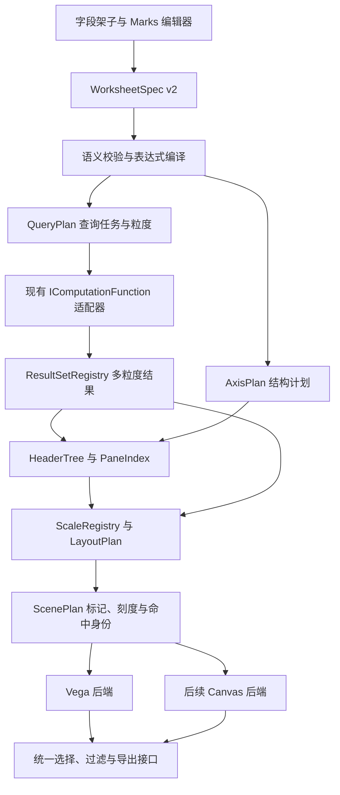

# Graphic Walker 多层嵌套与分面工作表设计

日期：2026-10-22。状态：整体设计提案；独立 V0 已落地到 `packages/worksheet-renderer`，具体范围和验证记录见 [V0 README](../packages/worksheet-renderer/README.md)。本文超出 V0 的部分仍是后续方案。

分析对象是本地仓库当前代码。最近提交为 2026-10-01，`fix(release): track toolbar icons in source checkouts`，定位号 `922bc236`。`@kanaries/graphic-walker` 的 package version 为 0.5.3；本地安装的 Vega 为 5.26.1，Vega-Lite 为 5.16.3。本文区分代码事实、已执行的验证和建议方案。

前置研究：[Tableau Desktop 2022.2 的表表达式、分区与渲染机制](/Users/observedobserver/Documents/tableau-research/tableau-desktop-2022.2.md)。本方案参考其机制，不承诺逐项复制 Tableau 行为。

## 1. 建议采用的方向

**自建工作表语义与布局引擎，首个生产渲染后端优先直接使用 Vega，保留切换到自建 Canvas 的边界。Vega-Lite 继续服务旧图表，不再作为新工作表的中间表示。**

需要自建的是字段实例、表表达式、查询粒度、表头树、pane 分区、范围共享、折叠与选择语义。无论最终选择哪个绘图库，这些都不能交给现有 `toVegaSpec` 继续隐式推断。

底层 Vega 可以接收明确的 group、坐标、刻度和标记数据，提供 Canvas/SVG 绘制、场景对象、事件和导出。它与 Vega-Lite 的声明式图表编译器是不同层次的依赖。第一阶段直接使用 Vega，能减少同时重做命中检测、导出和绘制生命周期的工作。

Canvas 后端值得做小范围对照实验，但不建议第一期同时维护两套完整后端。如果 Vega 在目标数据量上无法满足后文的性能或生命周期要求，再将同一份工作表模型交给 Canvas。这个选择应由样机结果决定，不能因为“自建”就假设更快。

优先落地范围：

- 行、列均支持多层离散嵌套，保留父子表头与局部排序。
- 内层使用分类坐标或连续轴，支持 bar、point、line、rect、text。
- 多度量并列，显式控制共享范围；保留每个度量的聚合和格式。
- Detail、Color 等增加标记粒度，不必增加表头。
- 折叠后按较粗粒度重新查询；支持可见区域渲染、选择和导出。

双轴、不同粒度的标记层属于后续扩展。完整 FIXED/INCLUDE/EXCLUDE、表计算、缺失日期补齐和关系模型不纳入首期承诺，但设计应预留独立计算阶段。

## 2. 当前实现到底卡在哪里

### 2.1 字段在进入渲染前已经被裁剪

[`lib/gog.ts:60`](/Users/observedobserver/Documents/GitHub/graphic-walker/packages/graphic-walker/src/lib/gog.ts:60) 的 `algebraLint` 对 Rows 和 Columns 执行：

```ts
LR.measureAfterDimension
LR.crossLimit(geom === 'table' ? Infinity : 2)
```

它会将维度移到度量前，并让普通图表每个架子最多保留两个维度。这个限制在 [`normalize.ts:166`](/Users/observedobserver/Documents/GitHub/graphic-walker/packages/graphic-walker/src/models/normalize.ts:166) 和 [`visSpecHistory.ts:532`](/Users/observedobserver/Documents/GitHub/graphic-walker/packages/graphic-walker/src/models/visSpecHistory.ts:532) 的 reducer middleware 中都生效。

因此，修改渲染组件本身不能恢复已丢失的字段；新模式必须同时替换规范化和编辑动作中的旧规则。旧模式仍需保留原行为，避免改变已有图表。

### 2.2 现有图表编译器只理解一个外层分面字段

[`lib/vega.ts:65`](/Users/observedobserver/Documents/GitHub/graphic-walker/packages/graphic-walker/src/lib/vega.ts:65) 按 analyticType 分出维度和度量。多度量生成重复视图；每个方向的分面只取 `rows/columns.slice(0, -1)` 中最后一个维度。没有通用表表达式、表头树或 pane 索引。

本次调用实际函数得到：

```text
输入 Rows = [Region, Category, SubCategory]

algebraLint('bar')   → [Region, Category]
algebraLint('table') → [Region, Category, SubCategory]

绕过 lint，直接调用 toVegaSpec：
  y.field   = SubCategory
  row.field = Category
  Region 未进入位置或分面编码
```

这说明直接把 `crossLimit(2)` 改成 Infinity，仍会丢失外层布局信息。Region 可能留在数据或选择字段中，但不会因此形成 Region 表头和分区。

### 2.3 多度量是多个独立运行实例

[`react-vega.tsx:204`](/Users/observedobserver/Documents/GitHub/graphic-walker/packages/graphic-walker/src/vis/react-vega.tsx:204) 根据行列度量数量创建占位容器，再对每组调用 `vega-embed`。多度量实例排在 CSS Grid 中，并通过 RxJS 传递部分交互信号。

这条路径能显示多度量，但跨实例的表头对齐、范围同步、导出和选择已有专门处理。继续把深层嵌套也拆成大量独立实例，会进一步增加协调成本。

### 2.4 当前 Observable Plot 路径也继承相同限制

[`lib/observablePlot.ts:502`](/Users/observedobserver/Documents/GitHub/graphic-walker/packages/graphic-walker/src/lib/observablePlot.ts:502) 先执行 `toVegaSpec`，再逐个转换成 Plot spec。它目前不是独立的语义编译器。切换 `layout.renderer` 不能获得更深的嵌套能力。

### 2.5 字段类型和身份需要补全

[`interfaces.ts:188`](/Users/observedobserver/Documents/GitHub/graphic-walker/packages/graphic-walker/src/interfaces.ts:188) 已经区分 `analyticType` 和 `semanticType`，也允许通道上的字段携带 `aggName`、`timeUnit`。这是可保留的基础。

但还没有独立、稳定的字段实例 ID，也没有明确的 `discrete | continuous` 属性。当前 [`channelEncode`](/Users/observedobserver/Documents/GitHub/graphic-walker/packages/graphic-walker/src/vis/spec/encode.ts:74) 会把 measure 的编码类型强制设为 quantitative，字段 pill 的颜色也按 analyticType 判断。离散度量和连续维度难以获得完整、一致的编辑语义。

[`getFieldIdentifier`](/Users/observedobserver/Documents/GitHub/graphic-walker/packages/graphic-walker/src/utils/index.ts:58) 目前只返回 fid。一个字段同时出现为年份、月份、两个不同聚合实例时，不能继续用 fid 表示所有视图身份。

### 2.6 查询层是最值得保留的边界

[`toWorkflow`](/Users/observedobserver/Documents/GitHub/graphic-walker/packages/graphic-walker/src/utils/workflow.ts:127) 已经负责过滤、计算字段、GROUP BY 和聚合。[`useRenderer`](/Users/observedobserver/Documents/GitHub/graphic-walker/packages/graphic-walker/src/renderer/hooks.ts:30) 执行 workflow 后调用 `fold2`，得到一份 `viewData`。

目前普通图表的所有视图维度进入一组 groupBy。它适合各标记使用统一粒度的图表，不能直接表示“Sales 层按 Segment 分组，Profit 层不按 Segment 分组”。新的查询规划器需要输出多份可复用的结果集。

`IComputationFunction(payload) → Promise<IRow[]>` 是现有浏览器、DuckDB 和远程实现的公共边界，应先兼容它。首期不要要求所有后端实现新 SQL 方言。

### 2.7 透视表已有一半需要的基础设施

| 已有能力 | 代码位置 | 复用方式 |
|---|---|---|
| 带类型的路径 key | [`pivotTable/utils.ts:20`](/Users/observedobserver/Documents/GitHub/graphic-walker/packages/graphic-walker/src/components/pivotTable/utils.ts:20) | 提取为通用路径编码，扩展字段实例与分支身份 |
| 递归表头树 | [`buildNestTree`](/Users/observedobserver/Documents/GitHub/graphic-walker/packages/graphic-walker/src/components/pivotTable/utils.ts:106) | 保留算法语义与测试，改成可容纳 axis slot 的结构 |
| 折叠状态与路径前缀处理 | [`pivotTable/core.tsx:20`](/Users/observedobserver/Documents/GitHub/graphic-walker/packages/graphic-walker/src/components/pivotTable/core.tsx:20) | 共用路径操作，折叠状态移入工作表状态 |
| 按较粗粒度查折叠值和总计 | [`getPivotGroupByCombinations`](/Users/observedobserver/Documents/GitHub/graphic-walker/packages/graphic-walker/src/components/pivotTable/query.ts:85) | 提取 grouping signature 规划，加入去重和并发上限 |
| Worker 构建表格模型 | [`workers/buildPivotTable.ts:39`](/Users/observedobserver/Documents/GitHub/graphic-walker/packages/graphic-walker/src/workers/buildPivotTable.ts:39) | 复用 worker 通道和纯函数边界 |
| 图表导出合成 | [`vegaApiExport.ts:22`](/Users/observedobserver/Documents/GitHub/graphic-walker/packages/graphic-walker/src/utils/vegaApiExport.ts:22) | 保留旧接口，给新引擎增加自己的导出适配器 |

不能直接把透视表每个 `<td>` 替换成 Vega 图表。现有模型是二维 `metric` 矩阵，DOM 逐格生成，而且一个单元格主要承载数值。图表 pane 还需要多标记、局部坐标、线段连接、裁剪和多层数据集。应复用语义和测试，不复制整个表格组件作为新架构。

## 3. 新架构及边界



职责必须明确：

- WorksheetSpec 保存用户意图，不包含像素位置或 Vega/Vega-Lite spec。
- QueryPlan 决定请求哪些粒度的数据，不负责表头尺寸。
- AxisPlan 和 HeaderTree 决定显示结构，不代替聚合计算。
- ScaleRegistry 决定数值到坐标、颜色等范围的映射。
- LayoutPlan 决定表头、绘图区、图例和滚动几何。
- ScenePlan 是可渲染的产物；后端不能自行补 GROUP BY、丢字段或改分面。

新代码先放在 `packages/graphic-walker/src/worksheet/`，保持 React/store 之外的核心为纯 TypeScript。等边界稳定再拆 workspace package，避免一开始把迁移成本放大。

## 4. 持久化设计：新增 v2，旧 IChart 保持原语义

### 4.1 不把新表达式藏进旧数组旁边

建议引入独立的 `WorksheetSpecV2`，与旧 IChart 构成显式 union。不要同时保存两份可编辑的 Rows/Columns 数组与 AST，否则拖拽、导入、undo 后很容易不一致。

以下类型展示核心契约，辅助类型将在对应模块定义。

```ts
type WorksheetDocument = IChart | WorksheetSpecV2;

interface WorksheetSpecV2 {
    kind: 'worksheet';
    specVersion: 2;
    visId: string;
    name?: string;
    fields: DatasetFieldDefinition[];
    instances: Record<string, FieldInstance>;
    rows: AxisExpr;
    columns: AxisExpr;
    marks: MarkSpec[];
    filters: FilterSpec[];
    calculations: CalculationSpec[];
    scales: ScalePolicy[];
    view: WorksheetViewOptions;
}

interface FieldInstance {
    id: string;
    sourceFid: string;
    analyticType: 'dimension' | 'measure';
    semanticType: ISemanticType;
    displayType: 'discrete' | 'continuous';
    aggregate?: IAggregator;
    transformRef?: string;
    label?: string;
    format?: string;
}

type AxisExpr =
    | { kind: 'empty'; id: string }
    | { kind: 'field'; id: string; instanceId: string }
    | { kind: 'nest'; id: string; outer: AxisExpr; inner: AxisExpr }
    | { kind: 'cross'; id: string; left: AxisExpr; right: AxisExpr }
    | { kind: 'concat'; id: string; items: AxisExpr[] };
```

字段元数据和 computed 定义由 `fields` 管理；每次放上架子生成独立 instance ID。聚合或排序变更保留该实例 ID；复制字段生成新 ID；拖拽只移动节点。表达式节点 ID 与字段实例 ID 分开，便于折叠、选择和 undo。

`semanticType` 保留数值、时间、类别信息；`displayType` 表达当前用离散表头还是连续轴。不再通过“measure 就 quantitative 编码”覆盖用户选择。

查询输出使用编译器分配的 result column ID。普通字段可复用 fid；不同日期转换生成不同计算列；同一 fid 的 sum、mean 分配不同输出列。不要把 UI instance ID 直接当数据库列，也不要只靠 `${fid}_${agg}` 承担全部新身份。

### 4.2 语法可递归，但第一期限制合法组合

表表达式支持递归存储，不表示任意混合都要渲染。编译器执行类型检查并返回结构化诊断。

| 组合 | 首期语义 |
|---|---|
| `Nest(D1, D2)`，两者离散 | 按出现的联合取值建立嵌套 |
| 离散维度链之后接连续字段 | 外层分区，内部连续坐标 |
| `Concat(M1, M2)`，两者连续 | 有序排列两个轴分支 |
| `Cross(离散前缀, Concat(...))` | 每个前缀内重复这些轴分支 |
| 连续字段作为 Nest 的分类父节点 | 拒绝，要求用户离散化或改为独立轴分支 |
| 一个分支同方向出现多个连续坐标且未 concat/overlay | 拒绝，不静默重排 |
| 字符串连续轴 | 拒绝，要求有效类型转换 |
| 聚合结果作为离散外层分区 | v2 类型可表达，首期给出 unsupported；先完成其聚合粒度规则再开放 |

首期支持普通离散度量标签或分类位置的前提，是明确先求聚合，再对结果值编码；不能把原始度量偷偷加入 groupBy。难以确定输出粒度的组合应显式拒绝。

UI 不需要让用户编写 `/`、`*`、`+`。拖入维度默认建立 Nest，拖入第二个连续度量默认建立 Concat。高级多度量操作再提供“并列、共享轴、叠加”。

### 4.3 Marks 是独立对象

```ts
interface MarkSpec {
    id: string;
    target: { rowBranchId: string; columnBranchId: string };
    type: 'bar' | 'point' | 'line' | 'rect' | 'text';
    channels: MarkChannels; // 引用 instanceId
    detail: string[];
    order?: SortTerm[];
    stack?: StackPolicy;
    layerOrder: number;
}
```

首期每个分支一个 Marks 配置，也允许从“全部”统一修改。之后同一目标增加多个 MarkSpec，才构成叠加层。AxisExpr 的 Concat 不承担 Layer 语义。

Measure Names / Values 编译为明确的 MeasureSet，成员记录 `instanceId + aggregate + format + unit`。沿用现有 fold 的思路，但不能继续用展示名称当身份，也不能对所有度量统一替换成一个聚合函数。现有 [`fold2`](/Users/observedobserver/Documents/GitHub/graphic-walker/packages/graphic-walker/src/lib/op/fold.ts:30) 可保留给旧路径。

## 5. 从表达式到 pane：不要把每个表头叶子都当作一个图表

这是实现时必须先定清楚的规则。表头的最细成员、pane 内的分类位置和独立绘图区是三个概念。

编译器先按分支生成 `AxisBranchPlan`：

```ts
interface AxisBranchPlan {
    branchId: string;
    facetLevels: DiscreteLevel[];
    position:
        | { kind: 'continuous'; instanceId: string }
        | { kind: 'band'; instanceId: string }
        | { kind: 'none' };
}
```

默认规范化规则：

1. 分支以连续字段结束时，之前的离散字段均为 facetLevels，连续字段为 position。
2. 分支全是离散字段时，最后一个为 pane 内的 band position，其他为 facetLevels。
3. 没有字段时 position 为 none，生成一个单位占位分支。
4. Concat 形成多个有序分支；相同离散前缀可共享表头节点。
5. Marks 的类型及显式设置可以选择表格 cell 模式，但不能靠后端自行决定字段归属。

HeaderTree 同时覆盖外层 facet 表头和终端 band 标签。PaneIndex 只使用 facet 路径与分支 ID 定位绘图区，band 成员留在绘图区内部。这样 `Region / Month` 的折线会在同一 Region 的 Month 位置间连接，不会变成每个月一个不能连线的微型图。

### 一个贯穿设计的例子

```text
Rows:    Region / Category / SubCategory
Columns: Year * (SUM(Sales) + AVG(Profit))
Color:   Segment
```

它编译为：

```text
row facets   = [Region, Category]
row position = SubCategory 的 band

column facets = [Year]
column branches = [Sales 连续轴, Profit 连续轴]

mark grain = [Region, Category, SubCategory, Year, Segment]
```

假设有 2 个 Region、每个 Region 有 3 个 Category、2 个 Year、2 个度量分支，而且组合都出现，则有 `2 × 3 × 2 × 2 = 24` 个绘图区。每个区包含该 Region/Category 下的 SubCategory 分类位置和 Segment 标记。

这里的 24 是本方案对 pane 的定义，不引用 Tableau 状态栏口径。它也不是 24 次查询。两个聚合具有相同 grain，可以由一份包含 SUM(Sales)、AVG(Profit) 的结果支持。

如果 Profit 的 Marks 移除 Segment，则分出第二个查询 grain。不能把已按 Segment 计算的 AVG 再简单取平均来获得正确的 Profit。

### 空组合策略

区分三个地方：

- 同一轴的 Nest 路径默认只保留实际出现的组合。
- 行列路径之间需要可对齐的二维位置，交叉处没有记录时保留空位置，但不生成假标记。
- 日期/分箱补齐是显式的数据扩展阶段，与保持空位置不同。

因此，模型可以保留完整行列索引，但不分配密集的 `rows × columns` 对象矩阵。空位置按需计算矩形即可。

## 6. 查询规划：按 grain 去重，不按 pane 发请求

### 6.1 新增 QueryPlan，保留现有执行协议

```ts
interface QueryPlan {
    tasks: QueryTask[];
    bindings: ResultBinding[]; // Marks/轴域/排序/总计如何使用结果
}

interface QueryTask {
    id: string;
    grain: string[]; // 编译后的分组表达式身份
    payload: IDataQueryPayload;
    purpose: 'marks' | 'headers' | 'sort' | 'summary' | 'domain';
    resultColumns: ResultColumn[];
}
```

一个查询的复用签名至少包括数据源和数据版本、过滤阶段及内容、变换表达式、grain、聚合、排序和 limit。使用规范化结构生成 key，不能仅凭字段名数组判定相同。

相同 grain 和过滤、变换条件的度量可合并成一条 aggregate query。不同 grain 的结果默认独立获取。只在可证明可合并时做二次聚合，例如 sum；mean 需要 sum/count，COUNTD、median 不允许由子组结果直接汇总。

`IViewWorkflowStep.query[]` 在客户端按顺序执行，**不是独立查询批次**。多 grain 不能塞进同一个 query 数组冒充 batch。兼容执行器应分别调用旧 `IComputationFunction`，通过有限并发调度。

建议首期默认并发上限 4，提供配置。每次更新分配 revision，旧结果不能提交到新视图。现有 callback 不支持 AbortSignal 时只能忽略旧结果；扩展后端能力才可真正取消。

### 6.2 ResultSetRegistry 保存结果来源

```ts
interface ResultSet {
    id: string;
    grain: string[];
    columns: ResultColumn[];
    rows: IRow[];
    completeness: 'complete' | 'truncated' | 'unknown';
    dataRevision: string;
}
```

分区索引只保存 row index 或 typed array 引用，避免每个 pane 复制整份数据。每个标记保留 resultSetId、结果行身份和所属 Marks，后续点击、解释数据和导出才能找回正确粒度。

旧协议没有完整性元数据。适配器只能在明确知道后端没有截断时标记 complete，不能以“拿到了若干行”冒充完整结果。可选的新执行接口可以增加 batch、取消、grouping sets、window、结果完整性等能力；没有声明支持的能力走兼容路径或显式报错。

### 6.3 折叠是一项查询操作

将某个 Region 下的 Category/SubCategory 折叠，展示的是该 Region 的汇总标记，不能只把若干子行隐藏。

规划器根据可见展开状态收集必需 grain，每种 grain 发一次查询，并映射到相应折叠路径。沿用 PivotTable 的较粗粒度查询原则，但不无上限地 `Promise.all` 所有前缀组合。可按完整 grain 查询后索引，或在支持时加路径谓词；必须保证分组身份一致。

总计行和普通成员行使用不同节点类型。缺失的维度列不能靠 undefined 隐式表示“这是一条总计”，ResultSet 和 grouping signature 必须明确记录它的粒度。

### 6.4 limit、分页和范围不能混用

旧 `config.limit` 是查询结果限制，不是 pane 数量限制。新模式分开设置：

- 查询或预览的行数限制。
- 每个父分组下的 Top N，属于分析语义。
- 可见 pane 数量，属于视口裁剪。
- 内存、表头节点和标记数量预算，属于资源限制。

首期可以对受控规模完整获取聚合结果，再虚拟化显示。结果超预算时显示明确状态，要求缩小数据范围或启用预览，不能静默隐藏后面的类别。

如果数据被截断，共享轴和总计不能标成全量正确。后端若能独立获取完整的 domain/summary，可继续显示这些完整结果；否则必须显示预览范围。仅在视口内取 min/max 会导致滚动时坐标轴跳动，应禁止这种默认行为。

### 6.5 LOD 和表计算的后续位置

v2 先加入计算阶段的接口，不承诺首期支持全部算子。行级计算、普通聚合、LOD 结果关联、补齐和表计算分别建计划节点。需要连接或 window 的计算，先检查 computation 能力。

运行累计必须拥有完整、有序的 partition；不能只对可见页累计。单一 grain 的结果也不能“顺便”模拟 FIXED。远程后端不具备所需能力时，只有取得完整且符合预算的结果才能在本地继续计算。

现有 [computation.md](/Users/observedobserver/Documents/GitHub/graphic-walker/computation.md) 与 [computation-divergences.md](/Users/observedobserver/Documents/GitHub/graphic-walker/docs/computation-divergences.md) 已记录客户端和 SQL 的边界。新设计不能假设类型声明中的每个 operator 都已由所有后端实现。

## 7. 表头、范围与布局算法

### 7.1 用路径树维护层级，用有序索引维护布局

从实际离散 tuple 建树。节点 key 包含 axis branch、instance ID、带类型的值及父路径。null、字符串 `'null'`、数字 1、字符串 `'1'` 必须不同。特殊数值沿用现有 pivot key 的显式编码策略；跨远程协议时按数据类型规范处理，不把 NaN 当合法 JSON 数字。

在现有树上增加子节点 Map 索引，避免每次插入在线性 children 数组里查找。先构树，再按父节点的排序规则排序；展示用有序 children，查找用 Map。

布局保存节点 depth、firstVisibleLeaf、visibleLeafCount、span、band/axis slot 的身份。节点高度变化或折叠后，重建可见叶索引和前缀位置数组。首期可以线性重算受影响轴，不必过早实现复杂增量算法。

设实际聚合行数为 N、层深为 D、可见标记数为 V。建路径索引目标为 O(ND)，排序成本另计；每帧绘制目标与 V 相关。稀疏数据仍可能对应巨大的逻辑二维网格，禁止提前分配全部网格单元。

### 7.2 分两遍测量布局

第一遍测量字体、表头、刻度和图例，得到各级表头宽高及 pane 最小尺寸。第二遍分配条带，计算父表头跨度、绘图区矩形、裁剪框和轴位置。

布局使用 CSS pixel；绘图后端负责 devicePixelRatio。滚动偏移、绘图区局部坐标和设备像素不得混在同一个字段中。

宽度或颜色改变通常不需要重新查询。字段粒度、过滤、时间截断和折叠改变才使相关查询失效。排序若依赖新度量，应增加排序查询，不能只改标签顺序。

### 7.3 domain 共享不是一个布尔值

旧 `layout.resolve` 的通道布尔值不足以表达“每个 Region 内共享 Sales 范围，但各 Region 独立”。新增：

```ts
interface ScalePolicy {
    id: string;
    channel: 'x' | 'y' | 'color' | 'size' | 'opacity';
    familyId: string;
    scope:
        | { kind: 'worksheet' }
        | { kind: 'prefix'; axis: 'rows' | 'columns'; levelId: string }
        | { kind: 'pane' }
        | { kind: 'fixed'; domain: DomainValues };
    includeZero?: boolean;
    reverse?: boolean;
    transform?: 'linear' | 'log' | 'time' | 'band';
}
```

familyId 区分 Sales、Profit 等轴族，scope 选择在该轴族的哪些 pane 间共享。共同范围与共同显示一根轴是两个决定：domain 可共享，但重复表头或间隔布局仍可能需要多处刻度。

domain 计算必须覆盖最终几何需求。堆积柱使用堆积后的正负端点，不能只看单条值；误差区间需要上下界；折线要处理 NULL 断点。颜色域按定义范围稳定分配，不能滚动到新 pane 就重新编号颜色。

### 7.4 视口与导出分别规划

屏幕维护完整逻辑布局，按滚动视口加 overscan 生成可见 ScenePlan。冻结表头、角区和绘图内容可以分成少量固定 surface，避免每个 pane 创建 Canvas 或 Vega View。

导出从逻辑布局重建全量或明确选定范围的 ScenePlan，不能截图当前虚拟视口冒充整表。超大 SVG/PNG 需要分页、分块或明确的尺寸限制；像素面积预算应在导出前计算。

## 8. 渲染方案评估

| 路线 | 能解决什么 | 主要代价 | 判断 |
|---|---|---|---|
| 继续拼完整 Vega-Lite facet/concat | 简单分面、现有图表迁移最少 | 多级表头、父分组折叠、公共轴、局部范围和虚拟化要绕开其组合模型 | 不作为新工作表核心 |
| 自建外层 DOM，每个 pane 嵌一张 Vega-Lite | 快速做外观样机 | 实例数、重复 axis/legend、布局协调、跨 pane 选择和全量导出成本高 | 仅限短期小规模样机 |
| 自建语义和布局，直接输出 Vega group/mark | 递归坐标空间、可控场景、Canvas/SVG、事件与导出 | 需要自行完成工作表编译和可见性调度，仍有场景对象开销 | 推荐首个生产后端 |
| 自建语义、布局、Canvas 与 SVG 导出 | 完全控制绘制批次、缓存和命中索引 | 需维护字体测量、图元、命中、交互、导出与可访问性；未必天然更快 | 有性能证据后投入完整实现 |
| 切到 Observable Plot | 可复用一些图元表达 | 当前 GW 路径仍经过 Vega-Lite；Plot 的 fx/fy 也不直接提供工作表层级管理 | 不构成本次问题的完整解法 |

### 8.1 Vega-Lite 的实际边界

本地安装的 `vega-lite/src/spec/facet.ts` 将 facet 的内部 spec 声明为 Unit 或 Layer；`compile/concat.ts` 对 shared axis 有警告路径。官方文档也指出 concat 不支持共享轴。它可以组合很多图，但这不等于能自然表达任意深的、有折叠语义的工作表表头。[Facet 文档](https://vega.github.io/vega-lite/docs/facet.html)、[Concat 文档](https://vega.github.io/vega-lite/docs/concat.html)

把 Region、Category、SubCategory 拼成一个字符串作为 facet key，只能生成平面类别。为了恢复父级标题、局部排序和折叠，还得另外保存树和自己布局。既然这些工作不可避免，就应把它们作为 GW 的正式模型。

不要把“当前 GW 生成器的限制”全部归因于 Vega-Lite。两者都有边界：GW 当前主动丢字段、只选一个 facet；即使修好它，目标工作表能力仍需要自己的语义层。

### 8.2 直接 Vega 如何接入

Vega 的 group 能递归包含坐标空间、标记、数据、scale 和 guide；View 支持 Canvas/SVG、事件、数据更新与导出。[Group 文档](https://vega.github.io/vega/docs/marks/group/)、[View API](https://vega.github.io/vega/docs/api/view/)

新后端直接依赖 `vega`，不调用 `vega-lite.compile` 或 `vega-embed` 的 Vega-Lite 模式。每张工作表使用一个或少量固定 View，以 viewport 级 group 承载可见 pane。不要为每个 pane 新建 View。

GW 提供明确的 pane rect、clip、尺度 domain/range、标记分组和稳定 datum ID。Vega 只执行这些绘图规定，不再次推导聚合、自动分面或自行分配整表宽高。

第一批图元的几何规则放在共享 `marks/` 中。bar 的正负基线、堆积端点、point 大小、line 的 series/order、rect 范围、text anchor 都定义明确。后端将其映射为 Vega primitive；相同输出随后也能给 Canvas 使用。

同一种视图的数据变化使用 changeset/signal 更新。结构发生实质变化才重新 parse，并调用旧 View 的 finalize。旧版本请求、异步字体测量和渲染结果都带 revision，避免迟到结果覆盖当前工作表。

### 8.3 自建 Canvas 需要承担的完整工作

Canvas 方案可以复用仓库已有的 d3-scale、d3-format、d3-time-format 和 rbush 依赖，但仍需自行实现以下职责。

- 按 clip 和 style 批量绘制图元，处理 DPR、缩放、滚动和脏区。
- 空间索引加精确命中测试。线段距离命中与点、矩形命中不同。
- 文本测量、字体加载后的重排、标签避让和日期/数值格式。
- 统一事件语义、键盘导航、可访问的文本/表格替代表示。
- 基于同一场景模型的 SVG 导出，保留矢量；不能把 Canvas 截图嵌进 SVG 当矢量结果。
- 导出中的字体、clipPath、ID 命名空间及大图分块。

起步采用 Canvas 2D 即可。只有明确测得密集散点或其他特定场景的瓶颈后，再考虑 WebGL。多一个 WebGL 后端不会自动解决表头、计算和导出。

### 8.4 通过统一接口保持可替换

```ts
interface WorksheetBackend {
    mount(host: HTMLElement): void;
    update(scene: ScenePlan, revision: number): Promise<void>;
    setSelection(selection: WorksheetSelection): void;
    export(request: WorksheetExportRequest): Promise<WorksheetExportResult>;
    dispose(): void;
}
```

后端返回 GW 定义的 hit/selection event，不向业务层泄露 Vega Item。Vega-specific theme 转换放在后端；工作表主题自身只包含颜色、字体、线宽、间距和格式等通用语义。

## 9. 交互、解释数据和导出也要迁移

当前 [`renderer/index.tsx:146`](/Users/observedobserver/Documents/GitHub/graphic-walker/packages/graphic-walker/src/renderer/index.tsx:146) 的点击回调读取 `e.item.mark.marktype` 和 `e.item.mark.group.datum`，并回溯日期偏移。它与 Vega 场景对象直接耦合。

新事件应包含：

```ts
interface WorksheetHit {
    paneId: string;
    markSpecId: string;
    resultSetId: string;
    resultRowIds: string[];
    grain: string[];
    predicates: DataPredicate[];
    geometryKind: 'bar' | 'point' | 'line' | 'rect' | 'text';
    screenPosition: { x: number; y: number };
}
```

predicates 使用源字段/计算表达式与原始类型值，不能用格式化后的标签。对年月、分箱要保存可回译的范围语义；同名表头的父路径必须进入谓词。

拖框跨多个 pane 时，选择应表示 tuple 集合或 OR-of-path-predicates。不能把各字段的选中值分别取集合后做笛卡尔积，否则选中 East/A 与 West/B 会错误包含 East/B。

[`IExplainContext`](/Users/observedobserver/Documents/GitHub/graphic-walker/packages/graphic-walker/src/lib/explain/types.ts:20) 目前接收整张视图的 dimensions/measures。新模式应通过适配器提供被点选 Marks 的真实 grain 和 measure。首期无法精确适配的多层、LOD 或集合选择，明确显示不支持解释，不把错误上下文交给分析器。解释结果中的小型 Vega-Lite 证据图可以继续保留。

CSV 导出要区分当前标记结果与原始明细。多 grain 不应无说明地拼成一张重复计数的表。可以按 Marks/结果集导出，并附分组列；整张工作表的文本表格导出走布局模型。

现有 `IReactVegaHandler` 和 `appRoot` 导出接口先保留兼容 facade。新能力另提供 `scope: viewport | full | selection`，旧调用默认保持原有语义。

## 10. 编辑器与兼容迁移

### 10.1 新模式的编辑行为

- 架子显示由 AST 投影出的字段顺序与分支分隔，不另存第二份权威列表。
- Pill 菜单分别提供“维度/度量”和“离散/连续”；日期粒度作为字段实例变换。
- 拖动验证目标结构。不能表达的组合显示具体原因，不通过静默删除字段纠正。
- 表头折叠保存 level/node identity 与数据路径，不使用当前可见索引。
- 单次拖拽、轴共享切换、Marks 更新、折叠都作为可撤销事务。
- 各分支的 Marks 配置有自己的颜色、Detail、排序和聚合。首期先开放并列分支，叠加 UI 后续提供。

### 10.2 不改变旧文件的默认解释

旧 IChart 继续走原 normalize、reducer 和 renderer。新工作表只走 v2 路径。不能全局放开 `crossLimit` 后让旧路径半支持深层字段。

提供显式 `upgradeChartToWorksheet`：读取已经规范化的旧字段和设置，生成独立实例；按旧编译器的结果确定位置与分面；旧多度量的排列顺序必须保留，不能自动改成更符合 Tableau 习惯的顺序。

已经被旧 lint 丢弃且没有保存在历史中的字段无法自动恢复，升级时不能凭空补回。旧数组也没有足够信息表达所有新组合，无法保证 v2 可无损降级。`toLegacyChart` 只对明确可表达的子集返回成功，其他情况返回诊断，不能丢字段再导出。

新格式不能只依赖 `$schema` 判别。当前 [`applyChart`](/Users/observedobserver/Documents/GitHub/graphic-walker/packages/graphic-walker/src/store/visualSpecStore.ts:691) 会移除 `$schema`，而 [`fillChart`](/Users/observedobserver/Documents/GitHub/graphic-walker/packages/graphic-walker/src/models/visSpecHistory.ts:610) 只重建旧字段。必须用持久化的 kind/specVersion，在进入旧填充器之前分流。

已有外部消费者可能忽略未知字段。不能承诺把 v2 文档交给旧软件时它会自动拒绝；发布接口应使用单独的格式能力声明或新版入口，避免旧软件误读并覆盖保存。

### 10.3 所有入口都要经过同一个格式分派

需要覆盖的入口包括 normalize、parseChart、store.importCode、appendFromCode、history snapshot/import、受控 spec props、PureRenderer 和 computation 导出 API。当前 `normalize()` 是新增入口，既有 import/export 并不统一经过它，只改这个函数会漏掉旧路径。

旧 `specToWorkflow` 的返回值是一份 IDataQueryPayload，不能伪装成多查询计划。保留旧函数并新增 `worksheetToQueryPlan`；对 v2 调用旧函数明确报错。

TerseSpec v1 不变。后续新增单独的 TerseSpec v2 authoring format，向 v2 canonical 单向展开。首期 UI 与 canonical 稳定后再扩展简写，避免同时调试两套新语法。

## 11. 文件级改造清单

下列新增路径均为规划，不是当前已有文件。现有文件引用已在本次检查中核对。

| 模块 | 修改或新增 | 具体内容 |
|---|---|---|
| 字段与文档类型 | `src/interfaces.ts`；新增 `src/worksheet/spec.ts` | v2 类型、稳定实例 ID、格式分派类型；保持旧接口可用 |
| 规范化与迁移 | `models/normalize.ts`、`models/visSpecHistory.ts`；新增 `worksheet/migrate.ts` | 先判版本；新增 validator；旧 lint 仅处理旧格式 |
| 表达式编译 | 新增 `worksheet/compiler/axis.ts`、`validate.ts`、`marks.ts` | Nest/Cross/Concat、terminal band/axis、诊断与 branch ID |
| 查询规划 | 新增 `worksheet/query/plan.ts`、`execute.ts`、`results.ts` | grain 去重、有限并发、revision、结果完整性、别名映射 |
| 计算适配 | `utils/workflow.ts`、`utils/workflowValidate.ts` | 复用受支持的 aggregate/transform，新增 plan 入口，避免破坏旧协议 |
| 表头与分区 | 新增 `worksheet/structure/tree.ts`、`keys.ts`、`paneIndex.ts` | 提取 pivot 的路径语义，稀疏索引、折叠与局部排序 |
| 布局与范围 | 新增 `worksheet/layout/`、`worksheet/scales/` | 测量、span、viewport、轴族与前缀共享 |
| 图元场景 | 新增 `worksheet/scene/`、`worksheet/marks/` | 统一坐标、clip、series、stack、datum ID |
| 首个后端 | 新增 `worksheet/backends/vega.ts` | 直接生成 Vega，不经过 Vega-Lite |
| 选择与导出 | 新增 `worksheet/interaction/`、`worksheet/export/` | 后端无关事件、tuple 选择、全量导出 |
| 渲染入口 | `renderer/index.tsx`、`pureRenderer.tsx`、`specRenderer.tsx` | v2 在旧 `useRenderer` 之前分流，避免先错误聚合再渲染 |
| Store 与编辑器 | `store/visualSpecStore.ts`、`models/visSpecHistory.ts`、`fields/encodeFields/*`、`fields/obComponents/obPill.tsx` | v2 actions、Marks 配置、双属性 pill、undo/redo |
| 透视表复用 | `components/pivotTable/utils.ts`、`query.ts`、`workers/buildPivotTable.ts` | 先提纯通用 key/tree/query-signature；旧 PivotTable 由适配器继续使用 |
| 公共导出 | `utils/vegaApiExport.ts`、`components/appRoot`、`interfaces.ts` | 旧 ref facade，新工作表导出实现 |
| 解释与查看明细 | `renderer/index.tsx`、`lib/explain/` 的调用边界 | 用被选中 Marks 的粒度构造上下文，不直接依赖 Vega Item |
| Schema 与文档 | `scripts/create-json-schema.js`、schema 发布路径、`computation.md` | 单独发布 v2 schema，标注后端能力和迁移规则 |

`SpecRenderer` 本身接收的已是聚合后数据；新 QueryPlan 不应塞进它内部再进行第二轮隐式查询。应在上层按文档格式选择 LegacyRenderer 或 WorksheetRenderer，后者统一执行自己的计划。

## 12. 实施阶段与验收门槛

这些工作量是设计估算，单位为工程人周，不是已经排定的日历工期。假设开发者熟悉 TypeScript、可视化和现有计算协议；不包括完整 Tableau 功能对齐。

| 阶段 | 估算 | 交付与完成条件 |
|---|---:|---|
| P0 语义样机与后端验证 | 1–2 | 固定样例跑通 4 层字段、两种 grain、共享范围、滚动；直接 Vega 样机，加 bar/point 的小型 Canvas 对照。测量后确认后端选择 |
| P1 v2 契约与编译器 | 2–3 | 版本分派、实例身份、表达式校验、旧格式升级、AxisPlan/QueryPlan 快照测试；此时仍不放开生产编辑器 |
| P2 数据与布局核心 | 3–4 | 多 grain 查询、稀疏表头与 pane、折叠、范围、虚拟化、完整性状态；正确处理 AVG/COUNTD |
| P3 渲染与交互 | 3–4 | 五种基础 mark、稳定颜色/轴、点击与框选、tooltip、PNG/SVG、字体和 DPR、释放资源 |
| P4 编辑器与兼容发布 | 2–3 | 架子操作、undo/redo、导入导出、PureRenderer、受控 props、feature flag、旧图表回归 |
| P5 高级组合 | 另计 3–6 | 不同粒度的叠加、双轴、更多排序/补齐和部分表计算；逐项发布，不与首期捆绑 |

首个可用版本约 11–16 工程人周。若由两位熟悉代码的工程师实施，考虑串行依赖与评审，日历时间仍宜按约 8–12 周规划。完整自建 Canvas 与 SVG 后端暂预留额外 4–8 工程人周，在 P0 后修正；该范围不能替代实际样机估算。

P0 不需要把所有图表做齐。它必须回答三个问题：当前计算协议能否在合理请求数内得到正确结果；工作表布局能否保持对齐；Vega 在目标视口下的开销是否可接受。

### 建议的性能验收预算

以下是拟定预算，尚未测量达成。基准环境需记录 CPU、内存、浏览器版本、字体、DPR 和视口大小。

| 场景 | 规模 | 目标 |
|---|---|---|
| 中型工作表冷布局 | 4 层、100 个可见 pane、20,000 个可见标记，聚合数据已到达 | model + layout + 首帧 p95 < 500 ms |
| 滚动 | 10,000 个逻辑 pane，只生成视口附近约 100 个 | 可见 scene 更新 p95 < 32 ms，原生滚动不等待重查数据 |
| 命中反馈 | 20,000 个可见标记 | tooltip/hover 反馈 p95 < 50 ms |
| 折叠/展开 | 使用已缓存的相关结果集 | 可见更新 p95 < 150 ms；未缓存查询单独计时 |
| 生命周期 | 50 次字段切换和 100 次视口更新 | 无持续 View/监听器增长，GC 后存活内存无持续上升趋势 |
| 查询规划 | 100 个 pane、2 个相同 grain 的度量 | 共享一个 marks aggregate task；域、排序、总计任务另列，不按 pane 线性增加 |

若 Vega 在完成视口裁剪和合理批处理后仍超过预算，且剖析显示时间或内存主要耗在 Vega scene/dataflow，而非 GW 建树、测量或查询，才升级 Canvas 为生产路线。导出、选择和可访问性同样是选型门槛。

## 13. 必须覆盖的正确性测试

| 类别 | 案例与断言 |
|---|---|
| 多层语义 | 3、5、10 层离散路径都保留；同名成员在不同父节点下不合并 |
| 内层分类位置 | Region / Month 的折线在 Region 内按 Month 连线；不能每个 Month 一个独立 pane |
| 连续维度 | 同一日期的离散年、连续月实例可同时存在，时区截断与查询分组一致 |
| 度量分支 | Sales 与 Profit 并列，单位、格式、domain family 不混用 |
| 标记粒度 | Color 移到 Detail 不改变聚合结果；从两者移除才改变 grain |
| 多粒度 | 同一绘图区两层具有不同 Detail；不能从细粒度 AVG/COUNTD 错误合并 |
| 折叠与总计 | 父汇总来自正确 grain；NULL 成员与总计节点不同；部分折叠不影响其他路径 |
| 稀疏布局 | 不存在组合保留空位置，不生成 0；不分配巨大二维对象矩阵 |
| 局部排序 | 每个父节点内按聚合结果排序；排序结果不串到另一个父节点 |
| 范围 | worksheet/prefix/pane/fixed 各自正确；堆积正负端点参与 domain |
| 选择 | 跨 pane 选择 A/a 与 B/b 不扩张成四个组合；日期与 bin 谓词可回译 |
| 异步与缓存 | 旧 revision 结果不覆盖新图；切换时区、数据版本、聚合使正确缓存失效 |
| 导出 | 全量导出含视口外区域；SVG clip ID 不冲突；高 DPR 与屏幕 CSS 尺寸一致 |
| 持久化 | v2 round-trip、undo/redo、受控 props、provider 存储不丢 AST/实例 ID |
| 旧格式 | 原 spec-compat fixtures、导出接口、Vega-Lite 和 PivotTable 路径保持既有行为 |
| 计算后端 | 同一 QueryPlan 在客户端、DuckDB 和代表性远程实现得到一致分组结果；不支持算子明确失败 |

测试分为纯编译/布局测试、计算 conformance、浏览器端交互和导出测试。主观截图不替代数值与 grain 断言，单元测试通过也不证明视觉对齐。

## 14. 本次已经验证的内容

本次没有修改产品代码，也没有实现新的渲染器。完成了相关代码路径阅读、官方能力核对及以下本地验证：

1. 使用本地 esbuild 将实际 `algebraLint` 与 `toVegaSpec` 打包调用，确认普通图表裁剪第三个维度；绕过 lint 后，外层 Region 仍没有进入位置/分面编码。
2. 核对本地 Vega-Lite 5.16.3 的 facet 类型与 concat shared-axis 警告路径，未仅依赖当前在线文档判断旧版本能力。
3. 运行 5 组已有测试，58 个测试通过：normalize、pivot query、pivot utils、pivot worker 和 Vega export utils。

执行命令位于 `packages/graphic-walker` 工作目录：

```sh
node ../../node_modules/jest/bin/jest.js --runInBand \
  src/models/normalize.test.ts \
  src/components/pivotTable/query.test.ts \
  src/components/pivotTable/utils.test.ts \
  src/workers/buildPivotTable.test.ts \
  src/utils/vegaApiExport.test.ts
```

normalize 测试虽然通过，但测试过程中打印了 MobX reaction 的 `currentVis.now` 相关异常日志。这是本次运行的基线现象，未在此设计任务中修复，也不能将“58 passed”描述成无警告通过。

尚未执行真实浏览器多层工作表、Vega/Canvas 性能对比或远程后端端到端测试，文中的性能和工期均为目标/估算。

## 15. 建议先落地的第一个改动

第一个实现 PR 应建立 `WorksheetSpecV2 → AxisPlan + QueryPlan` 的纯编译链，并用贯穿示例验证字段身份、pane 内位置和查询 grain；同时把 pivot 的路径编码提取成共享函数，保持现有测试通过。

随后做一个只读 WorksheetRenderer 样机，暂不接完整拖拽编辑器。它显示三至五层表头、两组度量、折叠和共享轴，并输出可检查的计划。这样可以先验证计算和布局是否正确，再扩大 UI 与渲染投入。

本次最关键的架构决定是让 Graphic Walker 自己拥有工作表语义。完成这一步后，Vega、Canvas 或未来其他后端才是可替换的绘制实现。
