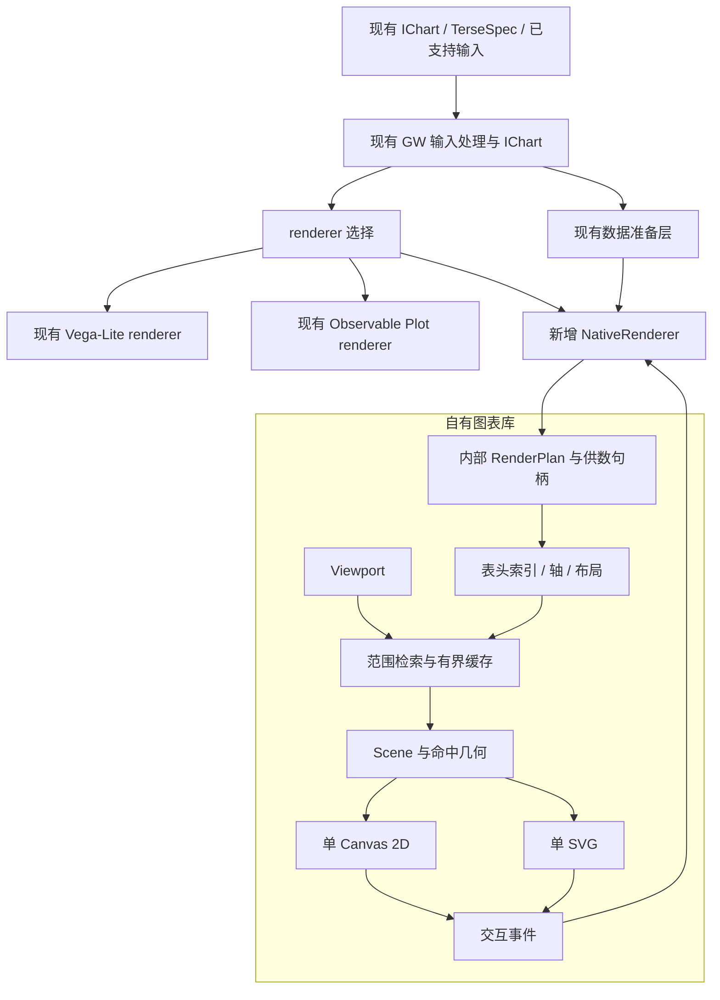

# 自有工作表渲染器：技术设计 v0.4

日期：2026-11-06。状态：本设计的首版渲染库与 GW native 接入已实施。需求见 [需求与验收](./worksheet-renderer-requirements.md)，范围见 [alignment](./worksheet-renderer-alignment.md)，设计审核见 [技术审核记录](./worksheet-renderer-technical-review.md)。当前公开 API 见子包 README 和 [GW 接入说明](./worksheet-renderer-integration.md)，实现与实测结果见 [实施记录](./worksheet-renderer-implementation.md)。本文保留设计契约，不将性能目标当作实测结果。

## 1. 设计结论与职责边界

以现有 Graphic Walker specification 为入口，新增一个使用自有图表库的 renderer。IChart 仍是权威格式，用户继续编辑和保存 `encodings / config / layout`。新 renderer 将现有配置及已准备数据映射到自有库，库负责布局、绘制、虚拟滚动、交互和导出。

现有 IChart 继续作为权威格式。内部 RenderPlan、表头树和 Scene 是临时实现数据，不是另一套创作或持久化 specification。新增渲染能力需要配置时优先复用既有字段；本版只为已确认需求中无法表达的前缀共享域和分组柱增加局部可选配置。

固定运算沿用 GW 既有计算 DSL，自定义运算沿用现有 SQL 能力。聚合、过滤及计算字段按现有流程执行，renderer 绑定已准备的结果。它们是输入来源，不是本期需要建设的计算模块；本项目不研究或引入 Tableau 的计算表达式，不新增、迁移或重写计算语言与执行器。

### 1.1 三层所有权

| 层 | 负责 | 边界 |
| --- | --- | --- |
| 现有 GW spec 与数据层，前置能力 | 既有计算 DSL/SQL 提供结果，既有可视化 DSL 提供配置，存储和历史保持原流程 | 不新增计算体系；继续使用 IChart |
| 新 native renderer 适配层 | 解释现有视觉配置、绑定结果列、映射主题与事件、生成内部渲染参数 | 位于 GW 集成侧；不经 toVegaSpec 再解释回本库 |
| 自有图表库 | 表头、pane、轴、图形几何、单 Canvas/SVG、窗口缓存和命中 | 不依赖 GW store、计算执行器、Vega-Lite compiler 或 Plot runtime |

库内仍有刻度、文字尺寸、坐标变换、堆叠位置和完整输入域推导等渲染计算。库不对输入值做业务 SUM/AVG，也不生成查询计划。外部算好的累计值或均值作为普通结果列绘制。

### 1.2 设计时的代码基线与对接点

以下保留技术评审时的代码基线。对应接入现已实施，当前 API、行为和测试结果见实施记录及 GW 接入说明。

| 设计时入口 | 已核对事实 | 对接方式 |
| --- | --- | --- |
| [interfaces.ts](../packages/graphic-walker/src/interfaces.ts) | IChart 保存 encodings/config/layout；IVisualLayout 的 renderer 为 vega-lite/observable-plot，另有 useSvg | 增加自有 renderer 值，沿用 useSvg 区分 Canvas/SVG |
| [models/normalize.ts](../packages/graphic-walker/src/models/normalize.ts) | 已支持 IChart、旧 IVisSpec、PartialChart、TerseSpec、有限 Vega-Lite-like 输入，并输出 IChart | 继续使用已有输入体系，不新增顶层输入类型 |
| [renderer/specRenderer.tsx](../packages/graphic-walker/src/renderer/specRenderer.tsx) | 按 layout.renderer 选择 ReactVega 或 ObservablePlotRenderer；传入数据、字段、配置与布局 | 在同层新增 NativeRenderer 分支 |
| [renderer/hooks.ts](../packages/graphic-walker/src/renderer/hooks.ts) | GW 在进入显示前准备 workflow 结果和 fold 数据 | 继续在库外准备数据并明确结果列绑定 |
| [lib/gog.ts](../packages/graphic-walker/src/lib/gog.ts) | 普通图表存在 crossLimit(2)，normalize 与 reducer 会使用它 | 新路径需解除显示深度限制，不能等字段被裁掉后才换 renderer |
| [lib/observablePlot.ts](../packages/graphic-walker/src/lib/observablePlot.ts) | 当前 Plot 路径先调用 toVegaSpec 再转换 | 新 native 路径直接映射 GW spec，避免继承旧 facet 限制 |
| [历史 V0](./worksheet-renderer-research-index.md) | 包含独立工作表格式、查询调度和单 Vega Canvas | 只复用有价值的显示实现与案例，不继承格式和计算边界 |

normalize 是现有正规化入口，但并非所有历史导入/导出路径都调用它；接入需逐条核对。以上为设计阶段的代码阅读记录；实际产品回归已随 S3 完成，证据见实施记录。

### 1.3 固定约束

- 用户不编写新的工作表 DSL，也不把 IChart 保存为 RenderPlan。
- 一个工作表一个控制器，pane 不拥有独立图表实例、React 根或绘图根。
- Canvas 模式的表头、主体、轴和高亮共用一个可见 Canvas，位图按视口尺寸分配。
- Canvas/SVG 共用内部显示计划与几何。
- 滚动不重新解释整份 spec、不扫描全量 pane、不测量整表文字。
- 数据读取只表达显示范围；计算及全局分析语义由 GW 处理。

## 2. 包边界与整体流程



renderer 选择暂定新增 `layout.renderer: 'native'`；这是建议命名，不是现有已支持值。`layout.useSvg: true` 选择 SVG，false/默认选择 Canvas。默认 renderer 继续保持既有行为，切换选择不转换整份文档。

```text
packages/graphic-walker/src/
  renderer/specRenderer.tsx   在现有位置选择 NativeRenderer
  vis/native-renderer.tsx    建议新增；适配现有 props、主题、事件
  lib/native/                建议新增；IChart/字段配置到内部参数的映射

packages/worksheet-renderer/src/
  core/          内部渲染参数类型、显示校验、诊断
  data/          范围供数接口、调度、缓存、已准备数据索引
  model/         表头拓扑、轴槽、pane 身份、scale registry
  layout/        条带尺寸、范围检索、文字测量
  scene/         图形几何、绘制命令、裁剪与命中
  backends/      canvas2d、svg
  runtime/       控制器、滚动、输入、选择、生命周期
  export/        视口/范围/分页导出
  react/         可选轻量封装
```

GW 适配层使用既有 IChart 类型；库本身不复制一份 IChart，不反向依赖 GW runtime。必要的类型可由适配边界投影或独立共享类型提供，不能为此引入循环依赖。内部布局参数可供独立嵌入使用，但不作为 GW 的新权威 specification。

构建导出 ESM 与类型，包根入口只暴露无 React 的控制器、数据接口和纯渲染类型，`/react` 为独立入口。React 依赖不得从根入口传递加载；Vega、Plot、GW store 与计算执行器均不进入新运行时依赖图。现有 V0 的 source export、Vega 依赖和 React 根入口需要替换，不能把 V0 已存在等同于发布包已完成。测试真实构建产物消费，不能只依赖 Playground source alias。已准备数据与内部参数足以驱动独立示例，不需要数据库或 GW store。

## 3. 现有 spec 映射与 Vega-Lite 局部兼容

### 3.1 复用现有字段

以下列出当前字段到 native renderer 的职责映射。对应现有 [interfaces.ts](../packages/graphic-walker/src/interfaces.ts)，不表示所有取值都进入首版支持范围。

| 现有配置 | NativeRenderer 如何使用 |
| --- | --- |
| `encodings.rows / columns` | 按现有顺序生成外层分面、pane 内位置、并列度量槽；保留所有被支持字段 |
| `config.geoms` | 映射基础 mark；首版单个目标一个 mark，不支持组合时给出诊断 |
| `encodings.color / size / opacity / shape / text / details` | 映射结果列的视觉通道和序列身份；逐项登记支持情况，不忽略不支持编码 |
| `fid / aggName / timeUnit / expression` | 由 GW 数据准备给出明确结果列绑定；renderer 可读取元数据定位结果，但不执行聚合/变换 |
| `semanticType / analyticType` | 沿用现有默认显示规则；解析成内部位置/样式类型，不把字段角色改造成新分析语言 |
| `layout.stack / zeroScale` | 映射已支持的堆叠几何和零点规则；normalize/center 等未实现模式明确诊断 |
| `layout.scale / resolve` 与外部 `scales` | 映射有效域、共享策略和比例尺；遵循已核对的覆盖顺序，不凭名称猜语义 |
| `layout.format / primaryColor / colorPalette / background` | 复用现有有效格式与主题设置，进入自有文字和样式实现 |
| `layout.size / useSvg / renderer` | 分配视口并选择显示实现 |
| `config.defaultAggregated / limit / folds`、filters 等 | 由 GW 数据层执行；不把 limit 当成渲染可见数量，不在库中再次 fold 或聚合 |

结果列绑定由 GW adapter 确定，库不解析 fid/aggName，不按显示名称拼结果键。adapter 复用 `getMeaAggKey` 与现有 fold 规则；绑定缺失或列类型不符时返回指向原字段路径的诊断。

```ts
interface ResultBinding {
  bindingId: string;            // 同一结果列及值解释方式的稳定身份
  fieldRef: string;             // 本次字段出现的 opaque 引用
  columnKey: string;            // 已准备记录中的真实键
  valueType: 'string' | 'number' | 'boolean' | 'time' | 'interval';
  positionType?: 'band' | 'linear' | 'time';
  label: string;
  unitKey?: string;             // 没有明确单位声明时不猜可共享性
  rawColumnKey?: string;        // 显示时间/区间值对应的原始值
}
```

`fieldRef` 到 IViewField 和原配置路径的映射只存在于 adapter。相同结果列可有多个 fieldRef，列身份与字段出现身份不能混用。adapter 用字段签名和重复出现序号建立引用表，数据重排不重建引用。完全相同的重复字段按签名内出现序号匹配；若将来要让它们拥有独立的持久状态，再论证原字段的可选 occurrence 标识，不能依赖窗口下标。

| 输入情形 | adapter 绑定规则 |
| --- | --- |
| 聚合的普通度量 | 使用现有 `getMeaAggKey(fid, aggName)`，sum/mean 可指向不同结果列 |
| 维度、已执行的表达式字段 | 使用现有流程提供的 fid 结果列；表达式内容不进入库 |
| raw 模式 | 使用原始结果列；不因 aggName 存在而再次聚合；被使用的 expr 没有结果时诊断，不静默删字段 |
| count、fold | 复用现有 count 字段及 `MEA_KEY_ID`、`MEA_VAL_ID` 的实际结果键，保留度量分支身份 |
| 已分箱/时间结果 | 显式绑定已有区间端点、时间值和原值；库不执行 bin/timeUnit 表达式 |

当前路径有部分时间显示处理位于 Vega 层，不能假定 hooks 已完成所有显示变换。S0 用既有时间/分箱 fixtures 核对列值、显示时区和格式，adapter 复用已有库外预处理并传入明确的时间坐标与原值。缺少必需结果时报告缺失，不在新库补一个表达式执行器。

### 3.2 从现有行列列表生成布局

保留现有 `measureAfterDimension` 的稳定分组规则。对每一方向，设正规化后为 `D1 … Dn M1 … Mk`，D/M 来自 analyticType；它们不等于离散/连续刻度。规则如下，两轴独立解析后交叉成 pane。

| 条件 | 外层表头 | pane 内位置与分支 |
| --- | --- | --- |
| `k > 0` | 全部 D 按顺序嵌套，哪怕其中某个 D 是 temporal/quantitative | 每个 M 对应一个数值位置槽；槽置于全部 D 层之内 |
| `k = 0, n > 0` | D1 到 Dn-1 | Dn 为位置字段；nominal/ordinal 用 band，quantitative 用 linear，temporal 用 time |
| `k = 0, n = 0` | 无成员层 | 一个缺省位置；是否能绘制由 mark 组合校验决定 |
| 多个 M | 共享上述 D 层 | 按字段顺序并列，不合并单位；行、列度量槽交叉，不生成子图实例 |

数值/时间维度只有作为终端位置时才生成连续轴，作为外层分面时仍是成员表头。例如 rows=[Region, Year, Sales] 的 Region/Year 均为表头，Sales 是位置度量；rows=[Region, Month] 且 Month 为 temporal 时，Month 是 pane 内时间轴。`defaultAggregated` 决定 adapter 的结果绑定，不改变这张布局表。

内部 pane 秩序固定为先成员路径、再度量槽。U1 的两 Region、每个三 Category、两 Year、两度量槽因此是 24 个 pane，Subcategory 是 band。该槽位排布是 native 的统一布局选择，与旧路径的最外层多 View 排布允许不同；A15 比较字段、值、域和格式，不要求复现旧图表拼接顺序。

同轴保留实际存在的联合成员路径；两轴交叉没有记录时保留空槽，不补假零。完全没有度量的 spec 不隐式创建 count；各 mark 仍需满足 3.6 的位置组合，所需绑定缺失就诊断。geom 为 auto 时，adapter 复用已核对的现有纯 mark 选择规则，选出的类型仍须通过首版能力校验。

内部使用轴槽、表头树和有序区间索引，不提供 Nest/Cross/Concat AST。每行决定规则都进入 S0 映射 fixture，断言表头路径、槽数、位置类型和 pane 数。

### 3.3 最小兼容扩展原则

`IChart`、`IChartSchemaUrl` 及既有保存流程继续使用。新增字段必须记录旧默认值、读写兼容与不支持时的诊断；不新增 document kind 或独立 schema 地址。

| 可能缺口 | 处理原则 |
| --- | --- |
| 旧二层限制 | 从 canonical rows/columns 的 normalize/reducer 中移出 crossLimit；各 renderer 在绘制前校验能力，不能改写存储字段 |
| 离散/连续显示角色 | 优先沿用现有规则；需要覆盖时为字段增加可选显示属性，旧 spec 无该属性时行为不变 |
| 前缀共享域、分组柱 | 使用下述原 layout 的可选 worksheet 配置；缺省保持已有 resolve/stack 含义 |
| 同字段重复实例 | 先验证现有引用能否区分；确有歧义再加可选 occurrence key，保留旧引用读入能力 |
| 冻结头、滚动锚点 | 组件参数或既有 layout/view state 扩展，不保存派生 Scene 和窗口记录 |

本版选择以下最小可选扩展，沿用 IChart，名称属于拟实施 API：

```ts
type ScopeOption = { mode: 'shared' | 'pane' }
  | { mode: 'prefix'; rowDepth: number; columnDepth: number };
// 下列属性合入既有 IVisualLayout；不是新的 specification。
interface WorksheetLayoutExtension {
  worksheet?: {
    scaleScopes?: { x?: ScopeOption; y?: ScopeOption };
    barLayout?: 'grouped';
  };
}
```

prefix 的深度按外层分面字段数计，不含 pane 内 band 或度量槽；两轴深度均为非负整数，至少一个非零，且不能超过对应层数。grouped 仅与 `stack: 'none'` 组合，冲突返回诊断。旧 spec 不含这些字段时继续使用既有默认值；切回不支持的 renderer 时保留字段并报告能力不支持。其他潜在扩展先用 fixtures 证明必要性，本版不预先新增。

结构正规化与 renderer 能力校验分开。解除的是普通图表 rows/columns 的显示深度限制，不连带修改 geographic 字段约束。旧后端收到超出能力的完整 spec 时默认停止该图绘制并返回 unsupported，不截取前两层显示；已有支持范围内的图表行为不变。

### 3.4 Vega-Lite 风格的局部兼容

复用配置词汇和明确子集，让已有主题、字段编码、格式化和测试基础设施能迁移。新路径直接生成自有渲染参数，不调用 toVegaSpec、Vega-Lite compiler 或 Plot 运行时。

Vega-Lite 的 encoding 支持通道到字段/常量的映射；axis/scale 以局部对象配置显示。这些形式适合复用。[Encoding](https://vega.github.io/vega-lite/docs/encoding.html)、[Axis](https://vega.github.io/vega-lite/docs/axis.html)、[Scale](https://vega.github.io/vega-lite/docs/scale.html)

| 局部形式 | 建议首版兼容子集 | 边界 |
| --- | --- | --- |
| `mark` | bar、point、line、rect、text，及已列出的静态样式 | 不承诺全部复合 mark |
| `encoding` | 已支持通道的 `field / type / value`，type 使用 quantitative/temporal/ordinal/nominal | field 指已准备结果列，不在此执行 aggregate/bin/timeUnit |
| `scale` | 已支持类型的 type、domain、range、zero、nice、reverse | 不隐含接受 signals、domainRaw 或所有 scale 类型 |
| `axis` | title、format、grid、tickCount，以及隐藏轴 | 不执行 labelExpr 或表达式引用 |
| `legend / format / style` | 现有基础设施实际使用并逐项登记的静态属性 | 每个纳入属性必须有转换与效果用例，不透传整个配置对象 |

例如内部某个轴的局部参数可沿用这种写法。它不是新的顶层用户 spec：

```ts
const xOptions = {
  field: resolvedSalesColumn,
  type: 'quantitative',
  scale: { zero: true },
  axis: { title: '销售额', format: ',.0f', grid: true },
};
```

适配层统一解析有效值，库不接收回调式 scale 配置。column 映射 x，row 映射 y。覆盖顺序固定为主题默认、外部 scales 的有效静态结果、原 layout.scale 中显式给定的属性；domainMin/domainMax 分别覆盖对应端点，未覆盖的一端仍须有完整域。layout.zeroScale 只在没有更具体 zero 设置时作为默认。resolve.x/y 为 true 对应 pane 独立，为 false/缺省对应 shared；worksheet.scaleScopes 显式给定时覆盖 resolve。

首版非位置通道 color/size/opacity/shape 使用 shared 域与统一图例；对应 resolve 为 true 时返回 unsupported-encoding 能力空态并保留配置，不强行按 shared 出图。pane/prefix 的首版支持范围是 x/y，逐 pane 的非位置图例不在本版支持清单内。

当前 IChannelScales 允许函数接收完整 values。complete 模式可由 adapter 在输入/主题变化时调用一次并缓存；windowed 模式必须由宿主提供已解析的配置，不能将当前窗口传进去冒充完整 values，也不能为调用函数偷偷加载全表。缺少有效配置时给出指向 scales 的诊断。

未支持属性产生诊断，不能字段名相同就宣称完整兼容。S0 固定实际使用属性清单及默认值，新增兼容项通过增量用例进入支持范围。上述覆盖优先级以固定测试校验；adapter 不修改调用者的配置对象。

现有 TerseSpec、PartialChart 和有限 Vega-Lite-like 输入继续走既有 GW 输入转换，转换后的权威格式仍是 IChart。若输入包含未支持的 transform、params/selection、repeat/layer/concat 或表达式，不能静默丢弃后称为等价导入；在转换前或能力校验时报告。来自合法 IChart 的 aggName/filters 等分析描述则保留给 GW 处理，不因它们存在而拒绝 native 渲染。

### 3.5 贯穿例子与受控交互

同一份 IChart 的 rows 为 Region、Category、Subcategory，columns 为 Year、Sales、Profit，config.geoms 为 bar。GW 已准备 Sales/Profit 对应的结果列；native renderer 保留其已有聚合标签与格式，并映射显示关系。

两 Region、每个三 Category、两 Year、两度量槽形成 24 个 pane。Subcategory 是 pane 内 band。增加一个外层维度只增长成员层级，不引入新运算符。切换 Canvas/SVG 只改变 useSvg，不改变这些字段与数据。

折叠和排序发出受控请求，GW 更新同一份 spec/view state 和结果数据。库只绘制返回值，不重聚合。选择事件返回精确 datum/字段引用，GW 再生成业务谓词。输入中含累计/均值等列时按普通列编码，不解析其计算公式。

完整输入可推导显示域，窗口输入使用完整作用域的显示元数据或固定域；滚动不改变颜色、轴域和成员顺序。具体规则见下节及 4.4。

### 3.6 首版 mark 与通道规则

| Mark | 必需位置与几何 | 顺序、空值和重复记录 |
| --- | --- | --- |
| bar | 一个分类/位置轴与一个数值轴；位置可为 band 或终端 temporal/quantitative 维度，按 D/M 角色明确方向；两个连续度量且方向不明时诊断 | none 缺省重叠；worksheet.barLayout=grouped 时按完整 series ordinal 分组；stack/zero 为按零点分开的正负堆叠，normalize/center 暂不支持；不合并重复记录 |
| point | 支持 band/linear/time 位置；位置可有一个缺省轴 | 每条有效记录一个点；缺失必需坐标不绘制，仍保留输入完整性统计 |
| line | 至少一个数值位置轴；另一个为有序 band/linear/time | series 不跨 pane；按 progression 轴顺序连接；相同位置按稳定 datum ordinal 排列；显式 null 断线，未提供的记录不自动补点 |
| rect | 首版保证 band×band，缺省位置视为单 band | 给定 cell 一个矩形；同 cell 多记录按稳定顺序覆盖并保留各 datum，不求和 |
| text | 首版保证 band×band 或缺省 cell，text 通道给值 | 用已解析格式显示给定值；null 显示约定的空文本，不填 0；同 cell 多记录不自动归并 |

bar 的 baseline 默认为 0，给定 fixed domain 可裁剪超界部分；零值仍有可访问目标，命中容差不改变数值。堆叠是在每个 pane/band/series 排列内对已给值生成几何端点，正负分别从零累加，不改变数据记录。series 顺序来自同版本的完整类别 ordinal，不随窗口重排；超出首版位置组合直接诊断，不猜一个新的分析含义。

月份等连续位置柱保留 time/linear scale，不能为出图而隐式改为 ordinal band。已有区间端点时按边界绘制宽度；其他连续点位置使用有效静态样式中的固定 CSS px 柱宽，默认值在 S0 对照既有样例冻结。grouped 在每个位置的给定宽度内分配系列槽，stack 按同一位置的正负值生成几何。库不做日期分桶、bin 或重聚合；窗口输入的成员身份与完整 domain 规则不变。T01/T07 增加月份柱图及连续数值维度柱图。

这两个 fixture 还要固定轴两端的柱是否裁剪、scale range 是否预留半柱宽；它们属于共同样式/布局参数，两后端不能各自推断，也不能为了柱宽改写数据 domain。

line 的 progression 轴由 adapter 决定：优先 x 的 band/time，其次 y 的 band/time，其余为 x。若 source 提供显式 sequenceOrder，按该顺序连线并在缺值处断开。否则先在稳定输入序列中按缺失 progression 值分段，各段按 progression 值及 datum ordinal 排序，再在数值缺失处断线；不能先删除 null 再连接两侧。windowed 的输入 ordinal 是 source 给定的全局序列编号，不是分页到达顺序。若不能提供完整序列或确定点序，该 pane 不能标完整。线段命中返回端点 datumKey/seriesKey 和命中位置，不能凭线段臆造一条业务记录。

| 通道 | 首版支持与身份作用 |
| --- | --- |
| color | 离散颜色或连续色标；line 首版只支持常量或离散系列颜色，连续颜色诊断；离散 color 参与 series |
| size | point 的非负面积、line 的序列常量非负线宽；其他未声明组合诊断；不影响业务值 |
| opacity | 已解析常量或数值映射到 [0,1]；按显式范围夹取；line 要求同一系列内有效 opacity 恒定 |
| shape | point 的有限符号集合；其他 mark 不接受 shape |
| text | text mark 的给定值和格式；其他 mark 的文本标签属于后续能力 |
| details | 仅用给定字段组合区分 series/交互身份，不新增记录或聚合 |

seriesKey 由 pane/度量槽、离散 color、details 组成的带类型元组确定，point 的 shape 可补充身份；未支持通道在 adapter 校验阶段报告。五种 mark 的静态样式白名单由 S0 fixtures 固定，不能透传任意 Vega-Lite 属性。

## 4. 外部供数与高基数窗口

### 4.1 两种输入方式

| 方式 | 本库负责 | 外部负责 |
| --- | --- | --- |
| `complete` | 对完整已准备记录建立显示索引，可推导成员关系和显示域 | 准备记录、绑定、稳定身份和成员顺序，明确输入完整性 |
| `windowed` | 按显示范围读取、取消、预取、缓存、淘汰和绘制 | 提供随机定位的成员索引、完整作用域显示域及对应记录 |

包内提供 `createPreparedDataSource`，将完整的已准备记录及显示元数据变为相同的范围读取接口。它建立索引，也可调用 mark 的纯几何规则准备显示域，包括堆叠端点；不执行业务聚合、过滤、计算表达式或重新分组。SQL、DuckDB、远程服务适配在包外，不要求为首版新建计算后端。

完整输入仍可能超过内存上限，必须披露输入、索引的构建成本。windowed 不是把完整数组传进库后只少画一些图元，轴元数据、记录和 Scene 都必须有按需路径。

### 4.2 读取协议

```ts
interface ReadVersion {
  sourceId: string;
  snapshotId: string;       // 已准备结果内容的不可变版本
  presentationId: string;   // 绑定、拓扑、顺序、展开与域计划的不可变版本
}
interface RankRange { start: number; end: number } // 半开区间
interface AxisWindowRequest {
  version: ReadVersion;
  axis: 'row' | 'column';
  range: RankRange;
}
interface PaneWindowRequest {
  version: ReadVersion;
  windows: Array<{ rows: RankRange; columns: RankRange }>;
  cursor?: string;          // 同一个版本与请求的续页，不是新查询
}
interface RenderDataSource {
  readonly version: ReadVersion;
  describe(signal: AbortSignal): Promise<RenderDataManifest>;
  readAxis(req: AxisWindowRequest, signal: AbortSignal): Promise<AxisWindow>;
  locate(req: LocateRequest, signal: AbortSignal): Promise<AxisLocation>;
  readDomains(req: DomainRequest, signal: AbortSignal): Promise<DomainBatch>;
  readPaneData(req: PaneWindowRequest, signal: AbortSignal): Promise<PaneBatch>;
}
interface RenderDataManifest {
  version: ReadVersion;
  rowLeafCount: number;
  columnLeafCount: number;
  status: 'complete' | 'preview';
  identityScope: 'stable' | 'snapshot';
  capabilities: {
    randomAxisAccess: boolean;
    locateByKey: boolean;
    maxAxisWindow: number;
    maxPaneWindows: number;
    domainPlanKeys: string[];
  };
}
```

所有响应回显完整 ReadVersion，库先校验版本再用内容；source 对象不能在运行中悄悄切版本。`describe` 必须与其 readonly version 一致。排序或折叠只改变显示关系时可保留 snapshotId，但必须换 presentationId；结果内容改变时必须换 snapshotId。计划、成员顺序、记录解释方式和域计划与 presentationId 绑定，不能复用一个 ID 指代两种含义。

没有 `open(QueryPlan)`，也没有 aggregate/groupBy/filter 参数。显示请求不决定结果如何计算。各响应至少包含以下字段；类型名是边界轮廓，字段含义是必须实现的契约。

| 响应/请求 | 必需内容与约束 |
| --- | --- |
| AxisWindow | version、axis、range、leaves、ancestors。每个 leaf 有稳定 key、全局 rank、带类型的成员路径、slotId 和所需 bandDomainId；ancestors 含稳定 key、层级及全局半开跨度。同父成员连续，路径/秩必须一致 |
| LocateRequest / AxisLocation | 请求为 version、axis、稳定 key 及原路径；结果为 found/rank、hidden/可见祖先，或 missing。库用保存的旧 rank 夹取相邻位置，source 不伪造存在的 key |
| DomainRequest / DomainBatch | 同版本的 DomainKey 数组；返回对应域、完整性、域来源类型，或 unavailable；分类标签可按 domainId 与 ordinal 区间分页 |
| PaneBatch | version、coveredWindows、panes、可选 nextCursor。每个 pane 回显行/列稳定叶 key 与 slotId、完整路径、records、paneComplete；每条记录有 datumKey、series/order 所需字段和原值引用 |

`coveredWindows` 表示该响应已经查明的逻辑矩形，不能把整个请求区间无条件复制进去。矩形内未列出的 pane 才可判定为空；未覆盖部分仍是 loading。已列出但 paneComplete=false 的 pane 不算空，也不能只把第一页显示为完整。响应中的稳定 key 必须与同版本 readAxis 的 rank 映射一致，这同时支持缓存复用与协议校验。空矩形不需要枚举其中的每个空 pane。

rowLeafCount/columnLeafCount 是展开状态下的布局槽位数，包含并列度量槽；pane 内 band 不额外计作 pane 行列。请求游标绑定原版本、原窗口和读取种类，不能移作另一个请求。无效 rank、重复 key、越界跨度、版本不符和不完整元数据分别产生协议诊断。

首版以完整 pane/series 为记录读取和几何编码单位。分页可以继续补齐一个 pane；超过单 pane 记录/几何预算时明确失败，不取前 N 行假装完整。band 标签和图元可以裁剪，但这不等于单 pane 数据已虚拟化；超长单序列的分段读取不在首版承诺内。

加载中、确实为空、预览、失败必须可区分。前向分页但无法随机定位的 source 不满足精确全表滚动合同，需改用 complete 或明确预览模式。窗口输入必须有稳定全局 ordinal，不按页内顺序补造。

### 4.3 调度、覆盖与缓存

调度顺序为建立 manifest/当前轴和必需域依赖，读取当前视口 pane，其次补齐当前页，最后 overscan 与导出。可并发的元数据和数据请求并发执行，但缺少布局或域依赖时不能提交猜测几何。默认总并发 4，overscan 每方向一屏，均受总预算约束；这些数值在 S0 测量后冻结。

缓存分两层，不能仅用当前窗口的行列下标作为身份。

| 缓存 | Key 与复用条件 |
| --- | --- |
| manifest、rank/成员页、域与覆盖矩形 | sourceId + snapshotId + presentationId + 请求种类/范围或 DomainKey；拓扑改变后不复用旧 rank |
| 已准备 pane 记录 | sourceId + snapshotId + 结果绑定签名 + 稳定行/列路径 + slotId；只在 source 保证同 snapshot 下该键内容不变时跨 presentation 复用 |
| 几何、命中与文字 | 另含布局、字体、有效域、样式和 viewport 版本，不能因记录可复用就复用错误坐标 |

排序可重新建立 rank→key 映射，再引用同一内容缓存。折叠父路径与展开子路径是不同键。若排序重新运行外部流程并提供了新 snapshotId，库不假定内容相等；纯滚动的热缓存零重复请求要求仍在同一版本内验收。

同版本重叠请求以区间覆盖表合并、去重，记录页按稳定 key 去重；不逐 pane 发送请求。旧窗口响应允许在仍有效的版本和预算内入缓存，只有当前输入所需版本能提交到画面。更新输入后停止为旧版本补页并取消本实例过期请求；不能真正取消外部操作时忽略其过期响应。

数据、成员、域、几何缓存分别计字节与条目。已呈现帧和正在构建的候选帧计入总驻留预算；可淘汰项按 LRU 释放，当前帧必需项暂时固定。优先削减预取和 overscan；必需工作集仍超限则报告资源诊断，不能靠淘汰可见数据制造反复加载。导出共享总内存/并发预算，读取优先级低于当前视口。

### 4.4 域作用域与渲染域来源

```ts
interface DomainKey {
  channel: 'x' | 'y' | 'color' | 'size' | 'opacity' | 'shape';
  familyId: string;         // binding/valueType/unit/scale 类型的明确兼容族
  domainPlanKey: string;    // mark、堆叠与系列排列的显示计划身份
  scope: { mode: 'shared' }
    | { mode: 'prefix'; rowPrefix: MemberPath; columnPrefix: MemberPath }
    | { mode: 'pane'; paneKey: string };
}
```

完整 ReadVersion 在请求封装中携带。familyId 默认按结果 binding 和通道区分，不同度量或未知单位不自动共享；显式声明可共享时也必须通过值类型与单位校验。prefix 是 rowDepth/columnDepth 对既有成员路径的截取，paneKey 包含两轴叶 key 和度量槽。首版仅 x/y 可取 pane/prefix，非位置通道只能 shared。固定 domain 是解析有效 scale 时的覆盖，不再引入一种数据查询。

| 模式 | 域来源 |
| --- | --- |
| complete 的 shared/prefix/pane | 对完整准备记录按纯渲染规则预建显示元数据；不在滚动帧扫描全表 |
| windowed 的 shared/prefix | readDomains 必须提供覆盖完整作用域的域；不随当前窗口估计 |
| windowed 的 pane | 可读取已有域，或在该 pane 完整记录到齐后推导；仅处理请求到的 pane，不枚举全部 pane 的域 |
| fixed/端点覆盖 | 完整 fixed 域不依赖统计；只固定一端时另一端仍须按上面的完整域规则取得 |

数值域回应包含有限 extent、是否完整、extentKind 为 value 或 stacked。堆叠图必须有覆盖正负累计端点的 stacked 域，不能把原值最大值当堆叠最大值；非堆叠图消费 value 域。createPreparedDataSource 用同一 mark 几何算法在索引阶段产生这些元数据，外部 source 只提供其已支持的 domainPlanKey；无法提供时返回 unavailable。库只能使用显式 fixed 域或报告诊断，不能发起业务统计查询。

空域与域未就绪不同。确认空数值域采用确定的占位范围 [0,1]，不生成记录；单值域的非退化扩展、zero/nice/reverse 由共同 scale 模块执行，输入完整域保持不变。颜色分类使用稳定 domainId、全局 ordinal 和完整基数，可按 rank 分页标签；颜色索引不因加载顺序变化。图例也须窗口化或明确截页，不生成百万条隐藏标签。

## 5. 层级拓扑与布局索引

### 5.1 存储模型

HeaderNode 保存稳定 key、父 key、层级、全局叶 rank 区间及展开状态。AxisSlot 保存分支与位置描述。PaneKey 由行叶 key、列叶 key 和度量槽身份构成；只在数据窗口或交互需要时创建 PaneDescriptor。

路径的规范编码由库的无状态 helper 与 source 共用：每个成员是 `[fieldRef, typedValue]`，typedValue 用 null/string/number/boolean/time/interval 标签区分；路径为有序数组，leaf 再带 axis 与 slotId，使用确定的数组序列化，不用分隔符拼字符串。有限数字按数值编码，-0 规范为 0；time 使用已明确的时间值，interval 编码两个带类型端点。缺失列和非法非有限坐标返回诊断，不能转成字符串混入成员。父路径参与 key，故两个父节点下同名成员不同。

typed positionValue 用于坐标与成员身份，raw value 另保留供 tooltip/宿主使用。不能从格式化标签恢复原值。windowed 必须返回同一编码的成员 key 和路径，locate 做往返校验；原始时间字符串等信息通过 datum 的原值引用交回宿主。

| 身份/顺序 | 契约 |
| --- | --- |
| GW 的 datumKey | adapter 必须提供稳定结果身份；可用既有 workflow 声明的分组键值与绑定签名组织已准备结果。raw 记录使用宿主稳定行键，不在库中推断 grain |
| 无稳定行键的重复 raw 记录 | 无法保证跨查询精确识别某条重复记录，GW adapter 返回身份能力诊断，不能宣称通过 A07；不从当前排序序号伪造稳定性 |
| 独立 complete 嵌入的 fallback | 可用 snapshotId+原始输入序号；同快照重排显示索引不重编号。manifest.identityScope=snapshot，跨 snapshot 的选择无法验证时为 pending，此模式不代表 GW 稳定身份接入完成 |
| 成员顺序 | source 提供逐父节点的成员 ordinal、稳定路径和全局 rank；不是只给一个排好序的 records 数组 |
| complete 的缺省顺序 | 独立 helper 用每个父节点下首次出现顺序；GW adapter 先按现有显示默认值或已执行排序准备明确的逐层 ordinal，不能以 helper 缺省冒充旧后端兼容 |

库只按 ordinal 构建显示索引，不按业务指标计算排序。跨 snapshot 的身份重新验证依赖宿主稳定键或当前已读记录，不能全表扫描去找选择。仍未知的目标保留 pending，不画到无关位置。

complete 模式的基线索引为稳定记录序号的 typed array，按 `(rowRank, columnRank, 原记录序号)` 排序，另存实际非空 row rank 与对应 offsets；在命中的行区间二分列范围。目录大小按真实非空行计，不固定分配 R+1，更不分配 R×C。成员目录按实际联合路径保存父指针和跨度，空交叉位置由坐标推导。初次排序、成员索引和域准备的耗时与内存单独报告。

windowed 模式只缓存当前窗口与祖先摘要；全局 rank、跨度和计数由 source 提供，不能先下载整棵树再称为层级虚拟化。记录序号、slot 数和偏移先做整数/预算预检，具体 typed array 位宽属于实现选择，不允许溢出后继续绘制。

### 5.2 尺寸与可见范围检索

首版 windowed 必需路径使用每轴统一的固定条带步长，可由用户指定；同一布局版本内不因某页文字或 band 基数改变其他条带。pane 内 band 使用该 pane 已确定的范围，标签可省略并按可见范围裁剪；超大单 pane 仍受 4.2 的完整性与容量限制。

complete 模式可在全量显示索引中使用按完整 band 基数计算的确定尺寸，再用前缀和/有序区间索引二分定位。windowed 首版不承诺任意局部变高行或按全表文本自动伸缩；未来要支持时必须增加明确的累计尺寸/偏移定位协议，不能仅凭当前成员页猜全局像素位置。固定步长下偏移与 rank 可直接换算。

每帧只检索可见叶区间、相交祖先和 overscan。祖先跨度可以远大于视口，按区间相交生成裁剪后的 HeaderFragment；标签放在当前可见片段内，保留完整路径 tooltip。不能遍历所有表头再执行 `intersects`。

为防深层冻结表头挤没主体，表头宽度有视口预算；支持显式紧凑路径显示与标签省略，完整层级仍可访问。用户可调整表头尺寸，但不能因省略文字删除语义节点。

### 5.3 文本、轴槽和复杂度

布局分两步：先按字体/格式测量当前布局所需标签及轴槽，再统一分配条带和生成几何。测量缓存 key 含文本、字体、字号、字重、locale；font-ready、主题、DPR/尺寸变化按职责失效。两个后端消费同一文本换行与截断结果，SVG 不再自行测量布局。

同一行/列条带的 axis gutter 取共享策略确定的宽高，不允许每 pane 自己撑开。高基数模式采用固定 gutter 或完整域刻度的测量结果，避免新窗口的长标签导致整表跳动。band 内部也要按可见范围裁剪，不能因为外层只有一个 pane 就创建十万个隐藏标签。

pane 数据就绪后，可建立 band/几何边界的范围索引，折线以线段边界索引，包含两端在外但穿过视口的线段。该准备成本计入索引和首次窗口成本；热滚动不能每帧扫描 pane 内全部记录，也不预先测量所有不可见文本。

设 R/C 为轴叶数，Hᵥ 为相交表头片段，Pᵥ 为可见加 overscan 槽位，Mᵥ 为可见候选几何和绘制 marks 的访问量。complete 初次建索引可随记录数与深度增长；热滚动目标为对数范围定位加 `O(Hᵥ + Pᵥ + Mᵥ)`，pane 内索引的查询成本也须计入报告。windowed 另含有界缓存检索及异步读取，不把网络延迟写进 CPU 复杂度，也不能只计最终画出的 mark 数而漏掉候选扫描。

## 6. 单 Canvas、冻结区与超长滚动

### 6.1 DOM 与滚动所有权

默认 DOM 固定为一个定位容器、下层固定的 Canvas/SVG、上层透明的原生 scroll host 及其无图形占位元素。绘制元素 `pointer-events:none`，scroll host 接收 pointer、滚动条与焦点事件，通过统一几何索引命中；tooltip/菜单在单独的 HTML 覆盖层。一个元素负责输入，不在两层重复注册移动逻辑。

普通范围允许原生 wheel/触控板滚动，由 scroll 事件同步逻辑位置。压缩范围在有界轨道上单独处理 wheel/键盘的逻辑增量，阻止该次输入再触发默认滚动；滚动条拖动仍按绝对物理位置映射。deltaMode、Shift 横向意图、触控板惯性由同一控制器规范化。若提供触屏拖动，也必须选定原生或受控的一条路径，不重复消费。

Canvas 大小为视口 CSS 尺寸乘有效 DPR。改变 `width/height` 会重置画布状态，因此仅 resize/DPR 变更时调整位图，并完整恢复 transform/clip/style。逻辑总宽高只存为坐标，不用于分配位图。Canvas 最大尺寸随环境变化，必须测能力与限制 DPR，不能假设所有设备都支持任意像素数。[Canvas 尺寸说明](https://developer.mozilla.org/en-US/docs/Web/HTML/Reference/Elements/canvas)

一个 Canvas 内分四个裁剪区，按主体、表头、角区、交互覆盖的顺序绘制。

| 区域 | x 方向 | y 方向 |
| --- | --- | --- |
| body | 跟随 scrollX | 跟随 scrollY |
| column headers | 跟随 scrollX | 固定 |
| row headers | 固定 | 跟随 scrollY |
| corner | 固定 | 固定 |

这是同一绘图上下文的四次 clip/transform，不是四个 Canvas。主体 pane 的 clip 还需与 body clip 求交，防止 marks 越过冻结区。固定图例占用的区域从主体视口扣除；HTML tooltip、菜单、可访问控件可以作为覆盖层存在，但不承担主体图表绘制。

### 6.2 坐标和帧提交

只使用三种明确坐标：逻辑工作表 CSS px、视口 CSS px、设备像素。以 body 为例，`screenX = bodyLeft + logicalX - scrollX`，y 同理；DPR 只在 Canvas 设备映射时应用。先减去逻辑视口原点，再交给绘图 API，避免用巨大绝对坐标绘制。

scroll 事件只更新目标位置并合并到下一次 rAF。每帧读取相同的快照、布局和视口版本，构建可见 Scene、绘制、原子提交命中索引与 `frameId`。命中测试始终使用当前已呈现帧的坐标；正在等待新帧时不能用新 scrollX 去解释旧画面。

### 6.3 超过浏览器原生滚动长度

原生占位元素长度有浏览器限制，首版不能只写 `spacerHeight = 全表高度`。ScrollMapper 在运行时或兼容测试中获得安全物理范围；范围内使用一比一映射，超出时使用有界物理滚动轨道。

逻辑偏移是唯一真值。两轴分别决定是否压缩；超出安全物理范围的整轴启用比例映射。滚轮/键盘按逻辑像素增量，滚动条拖拽按物理轨道比例映射到 `[0, logicalExtent - viewportExtent]`，程序化跳转按 rank 定位。

库写 scrollTop/Left 前先舍入/夹取物理目标，记录最新期望物理位置。异步 scroll 事件与该位置在容差内相等时是回声，不反推逻辑位置；不相等时按实际绝对物理位置处理用户滚动。不能只靠一个布尔标记，因为浏览器可能合并多次事件。resize 或长度变化也按同一流程更新映射，不累加舍入误差。极长轨道降低拖拽精度，因此保留键盘精调和按成员跳转。

计算总范围先做数值安全检查，超出可安全表示的索引或偏移返回资源诊断；不把 JavaScript Number 当无限精度。S0 必须验证首端、末端、反向滚动、resize 后比例、折叠后长度缩减和滚动条拖动。B4 单独覆盖这一层，不与网络性能混测。

### 6.4 锚点与线程

排序、折叠、尺寸变化前保存最靠近视口起点的稳定叶 key 及单元内偏移，变化后通过 locate 恢复。叶被移除时依次回退到仍存在的祖先、相邻位置，再夹取合法范围。不能只保留旧 scrollTop，让相同像素突然指向无关成员。

第一版以主线程 Canvas 2D 绘制作为可靠基线，显示索引准备可在 worker，外部计算不属于本库线程设计。OffscreenCanvas 是可选加速，只有测量显示主线程绘制成为瓶颈时才引入；不能把它作为满足单 Canvas 的必要条件。若使用 transferControlToOffscreen，转交的是同一可见 Canvas 的绘制控制，不是每个 pane 新建离屏画布。[HTML Canvas 标准](https://html.spec.whatwg.org/multipage/canvas.html)

## 7. Scene 与双后端

### 7.1 统一命令模型

```ts
interface SceneFrame {
  frameId: number;
  inputRevision: number;
  version: ReadVersion;
  layoutRevision: number;
  viewport: Viewport;
  commands: DrawCommand[];
  hits: HitRegion[];
}
// 命令包括 rect、path、symbol、textRun、clip 与 transform。
// 每项带稳定 ID、z-order、bounds、style，以及可选的语义目标 ID。
```

Scene 只覆盖视口/overscan 的必要几何；overscan 数据不必全部转成绘制命令。路径使用可序列化的命令段，共同生成 Canvas path 和 SVG `d`，不能让 Path2D 成为跨后端公共格式。文本包含已经确定的行、基线与对齐。

每种 mark 插件负责列绑定要求、对给定显示值的 domain 贡献、几何编码和命中几何，不提供查询或聚合回调。Canvas/SVG 只实现基础命令，不各写一份 bar/line 语义。选择高亮和焦点环也是同一 Scene 的命令。

### 7.2 Canvas 后端

默认全量重画当前视口，复用样式、几何缓冲和文本测量缓存。保留绘制顺序及透明度语义后才合并批次，不按颜色全局重排。若剖析证明需要，再加 dirty rect 和同画布滚动复用；冻结区、透明度、clip 和高亮必须参与失效。

首版不为 pane 建位图缓存，也不用隐藏颜色拾取 Canvas。命中通过几何索引完成，避免多个画布变成事实上的图表拼接。导出允许创建一个有预算的临时目标，结束即释放，它不是交互工作表的组成部分。

### 7.3 SVG 后端

每个工作表一个根 SVG，可见命令通过稳定 key 更新 `<g>`、`path`、`rect`、`text` 与共享 defs。四个冻结区域使用同一坐标计划的变换和 clipPath，元素离开窗口后移除，defs 引用也要回收。clip ID 包含工作表实例与几何身份，避免多工作表冲突。

SVG 使用相同交互索引；DOM target 仅作候选提示，统一复核 clip、z-order 与身份。坐标变换依照 SVG viewport/viewBox 模型，但不依赖浏览器重新决定图表布局。[SVG 坐标规范](https://svgwg.org/svg2-draft/coords.html)

两后端追求语义和几何一致，允许抗锯齿与字形栅格化差异。超过 SVG 元素预算时给出明确提示，可由用户切换 Canvas；不能静默删 marks。切换后端重建绘制目标，不重复读取相同数据、不重置选择与滚动。

## 8. 交互、状态与可访问性

HitRegion 索引只包含可见且可命中的几何，先按区域/网格筛选，再做矩形、点距离或折线段距离检验。线的边界盒必须考虑穿越视口而端点在外的线段。复杂重叠按稳定 z-order 选择，容差用 CSS px；命中索引重建也计入帧预算。

Selection 保存第 10 节定义的稳定显示目标，不持有后端节点。目标包含 mark、pane/slot、datumKeys、系列身份和原值。多选发出精确目标列表，不生成查询谓词或对取值做笛卡尔扩张。派生字段如何映射回原始数据、时间范围如何转为过滤器，由宿主完成。

虚拟化不清空选择；输入数据版本变化后重新验证存在性，无法验证的目标标为 pending，不画在不相关位置。维度过滤、查看明细、Explain 由宿主消费事件，渲染器不直接调用 GW store 或 Vega signal。

权威状态仍是宿主现有 IChart 和 view state；adapter 派生 RenderPlan，库的 RuntimeState 保存像素偏移、hover、读取任务、缓存和 frame。RenderPlan 不写回或取代 IChart。宿主管理 undo/redo，可将接受的折叠操作加入历史，普通滚动与 hover 不要求写历史。

Canvas 不向辅助技术自动暴露绘制对象，因此使用单个语义容器、当前焦点代理和按需数据视图，提供摘要、路径、位置、值、展开状态与键盘操作。语义 DOM 只覆盖当前所需内容，不创建百万隐藏单元。[Canvas 可访问性说明](https://developer.mozilla.org/en-US/docs/Web/HTML/Reference/Elements/canvas#accessibility)

## 9. 更新与失效

### 9.1 版本与提交

| 版本 | 谁分配、何时改变 |
| --- | --- |
| sourceId / snapshotId | 结果提供方分配。snapshot 内容不可变；结果记录或值改变必须换 ID |
| presentationId | 由构造 source 的一方分配，adapter 消费同一 ID 并绑定显示计划。字段绑定、拓扑、成员顺序、展开状态、域计划变化时更换；单纯主题或视口变化不要求更换 |
| inputRevision | 控制器每次接受整包 update 时递增，保证连续更新有明确的最新目标 |
| layoutRevision / frameId | 库分配，分别标识字体/尺寸/几何版本和实际已呈现的帧 |

`update` 一次提交 plan、source 与已解析 view state，库校验它们引用的 ReadVersion 和绑定合同。不同版本的 props 不单独落地。输入验证失败返回 rejected 和诊断，保留上一个有效输入；新有效输入超过旧候选输入时，旧 update 返回 superseded。

帧流程为 `validating → awaitingMetadata → rendering → committed`。awaitingMetadata 时可以暂留上一个完整帧，但必须标 stale/aria-busy，禁用针对旧数据的选择、tooltip 和导出默认动作，并停止旧版本补页。当前输入的拓扑、尺寸和必需域就绪后，原子提交新 Scene 与命中索引；记录缺页以明确 loading 槽显示，不要求等待全表。update 的 committed 指这次一致提交，不表示所有数据读取已结束，完整性由 loadState 另报。

stale 期间冻结旧画面，滚动输入只更新新输入的目标视口；元数据就绪后按最新目标定位。不能把旧 marks 平移到尚未知晓的新区域，也不能为维持旧画面继续占用补页并发。

若 stale 期间有用户滚动，以该目标视口为准，在新范围内夹取，不再执行 6.4 保存的旧锚点恢复；没有新滚动时才恢复旧锚点。stale 覆盖提示要能解释滚动条已移动、图像仍在等待的状态，不能只悄悄冻结。

每次准备提交前检查 inputRevision、ReadVersion、layoutRevision 和目标 viewport。若已被更新覆盖则丢弃候选帧。异步数据完成不能绕开该检查。颜色变化或后端切换可复用有效记录和索引，但仍产生新的已提交 frameId；事件带的是已呈现帧身份，不是尚未显示的目标位置。

### 9.2 受控请求

排序和折叠由库发出 `{requestId, basePresentationId, target, intent}`，宿主决定是否更新既有配置和结果。生命周期为 `pending → accepted | rejected | superseded | expired`。

- accepted 必须随对应的整包 update 明确回传 requestId，或者确认该请求是无变化操作；库不根据经过时间推断接受。
- 宿主可调用 `rejectRequest(requestId, reason)`。同目标的新请求可替代旧请求；改变了相关字段/版本的外部输入也可使旧请求 superseded，主题或尺寸更新不取消全部 pending。
- 到达 S0 确定的无响应期限后发出 expired 事件并解除等待提示，保持原状态。晚到响应必须基于仍有效的 basePresentationId，否则拒绝或由宿主作为新的外部更新提交。
- pending 期间显示意图提示，不用旧子级数值生成父值。选择、焦点和滚动锚点按稳定 key 保存。

### 9.3 失效与资源释放

| 变化 | 供数与缓存 | 布局/几何与画面 |
| --- | --- | --- |
| 滚动 | 仅读缺页，同版本命中缓存不重复请求 | 按目标窗口生成 Scene 并原子提交 |
| hover/选择 | 不读业务数据 | 更新覆盖几何，沿用已呈现帧坐标 |
| 主题/格式/字体 | 相同域计划下不读数据；函数式 scale 在 adapter 按完整输入重新解析 | 字体/格式变化重新测量，颜色仅重编码 |
| 尺寸/DPR | 必要时扩大窗口 | 计算尺寸和刻度，位图 resize 后恢复上下文状态 |
| 请求排序/折叠 | 等待宿主确认 | 仅 pending 提示，不本地改写数据 |
| 新 presentation | 新 rank/域计划；稳定 pane 内容满足合同才可复用 | 校验后恢复锚点并提交 |
| 新 snapshot | 停止旧读取，不混用内容 | 旧帧暂标 stale，再提交新帧或 loading |

`dispose` 幂等：取消本实例读取与导出、断开事件/ResizeObserver、释放缓存/后端资源；未完成 update 返回 disposed，未完成导出以取消结果结束。释放本实例访问句柄，不销毁共享 source 或宿主数据连接。卸载后的异步响应不能再触发绘制或事件。

## 10. 接入 API 与事件

### 10.1 控制器

GW 使用方仍通过原来的 IChart 选择 renderer；以下为增加枚举后的示意，当前尚不可调用：

```ts
const nativeChart = {
  ...chart,
  layout: { ...chart.layout, renderer: 'native', useSvg: false },
};
const input = adaptGraphicWalkerToNative({
  chart: nativeChart,
  data: preparedResult,
  resultBindings,
  theme: resolvedTheme,
});
const view = createWorksheet(host, input);
const unsubscribe = view.on('selectionChange', handleSelection);
const receipt = await view.update(nextInput);
view.scrollTo({ rowKey, columnKey, align: 'nearest' });
await view.export({ format: 'svg', scope: 'viewport' });
unsubscribe();
view.dispose();
```

以下成员构成首版控制器合同。参数均为库的渲染类型，不导入 IChart/IViewField。

```ts
interface WorksheetInput {
  version: ReadVersion;
  plan: RenderPlan;
  source: RenderDataSource;
  backend: 'canvas' | 'svg';
  viewState?: ControlledViewState;
  requestResults?: Array<{
    requestId: string;
    status: 'accepted' | 'rejected';
    reason?: string;
  }>;
}
```

RenderPlan 最少包含结果绑定、已决定的两轴角色与度量槽、mark/通道、domainPlanKey/作用域和已解析样式；其绑定/显示签名必须与 version 及 source manifest 相符。它不含计算表达式或数据查询算子。完整数组入口通过 createPreparedDataSource 包装后进入相同合同，不能另走一套不带版本的渲染路径。

| 成员 | 结果与行为 |
| --- | --- |
| `createWorksheet(host, input, options?)` | 创建一个控制器；input 带 RenderPlan、绑定 source 及 view state，backend 为 canvas/svg |
| `update(input): Promise<UpdateReceipt>` | 返回 inputRevision、committed/superseded/rejected/disposed，以及提交时的 frameId；不通过返回 void 隐藏异步完成时机 |
| `on(event, handler): () => void` | 注册 typed event，返回幂等退订；同一输入事件只派发一次 |
| `scrollTo({rowKey?,columnKey?,align})` | 两轴均为稳定 key；未知 key 走 locate，可报告 missing，不通过全表扫描定位 |
| `setSelection(targets)` | 受控替换精确目标；程序化设置默认不回发用户 selectionChange，避免循环 |
| `getViewState()` | 返回已提交帧的版本、逻辑偏移、锚点、选择、焦点和加载状态的只读快照 |
| `focus(target)` | 设置语义焦点，必要时按 key 定位；尚未载入时报告 pending |
| `resize({width,height,dpr?})` | 手动尺寸入口；默认由控制器的 ResizeObserver 驱动，options 可关闭自动观察，不能启用两个尺寸所有者 |
| `rejectRequest(requestId, reason)` | 结束对应受控请求，保持当前显示状态 |
| `export(options, signal?)` | 返回带版本/范围的导出结果或明确失败；按第 11 节处理完整性、分页和取消 |
| `dispose()` | 幂等释放，之后的更新返回 disposed，不重建后台任务 |

RenderPlan 是内部参数，不带新的 `$schema` 或 document kind，不进入保存/导入。React 封装只管理同一控制器的生命周期，卸载清理订阅；不为每个 pane 创建组件。宿主改变 backend 时重建绘制目标，保留有效 source、滚动与选择。

### 10.2 事件载荷

涉及画面命中的事件都带 `{inputRevision, version, frameId}`。受控请求另带 requestId/basePresentationId；未能建立有效输入时的 diagnostic 可没有 frameId。字段引用均为 opaque fieldRef，adapter 再映射原配置。

```ts
interface SelectionTarget {
  kind: 'datum' | 'segment';
  paneKey: string;
  slotId: string;
  markId: string;
  datumKeys: string[];  // datum 为一个键，segment 为端点键
  seriesKey?: string;
  values: Array<{ fieldRef: string; value: unknown; raw: unknown }>;
}
interface Diagnostic {
  code: string;
  severity: 'info' | 'warning' | 'error';
  recoverable: boolean;
  fieldRef?: string;
  configRef?: string;
  message: string;
}
```

| 事件 | 除公共版本外的必需内容 |
| --- | --- |
| ready | 首次提交 frameId、backend、loadState；不暗示全部窗口已加载 |
| selectionChange | 完整 targets、replace/add/toggle/clear 操作、来源 pointer/keyboard；数组保持精确 tuple，不分列去重后交叉 |
| collapseRequest / sortRequest | requestId、basePresentationId、目标路径/fieldRef、请求的展开状态或排序意图 |
| requestStateChange | requestId、accepted/rejected/superseded/expired、原因及接收版本 |
| viewStateChange | 已提交偏移、锚点、焦点、来源；普通滚动不用写 IChart 历史 |
| loadStateChange | 当前输入和已呈现帧的版本、stale/loading/complete/preview/error、覆盖范围与诊断 |
| diagnostic | 上述结构；adapter 将 fieldRef/configRef 映射为 encodings.rows 等原路径 |
| metrics | 分阶段耗时、缓存/驻留统计与版本；关闭时不构建昂贵调试数据 |

典型诊断区分 unsupported-encoding、missing-binding、unstable-datum-identity、domain-unavailable、source-contract-violation、version-expired、resource-limit。unsupported 由 UI 显示能力空态，不是未捕获异常；不能因此删除 spec 字段或自动切到其他后端。

### 10.3 现有 GW callbacks 与 ref

当前 `renderer/index.tsx` 的点击处理直接读取 `e.item.mark`，并用完整 viewData 反查时间原值。新路径增加 renderer-neutral 的结构化选择分支，直接消费 targets 与 raw 值，不伪造 Vega Item 树，也不为每次点击扫描完整结果。旧 Vega 分支继续处理其原事件。

原 onGeomClick 的单击时机与单目标字段值由 adapter 映射，底层私有 e.item 不作为 native 合同。多选/框选通过结构化事件传递精确目标；旧宿主接口若只能接收各字段值集合，不能把多目标降成笛卡尔积过滤器。原字段计算/过滤仍由宿主处理，本库不新增谓词执行能力。

现有 IReactVegaHandler 的四方法继续返回 `Promise<string[]>`：getSVGData/downloadSVG 返回当前完整视口的单元素 SVG 文本数组，getCanvasData/downloadPNG 返回单元素 PNG data URL 数组；空数据视图仍可导出其空态。加载未完成时等待或以明确失败结束，不能用空数组掩盖错误。与旧全 View 导出的范围差异必须写入接入说明和 UI 标签；有限范围/分页导出使用显式 options，不让旧方法隐式加载全表。

onReportSpec 若保留后端调试报告，需标明 renderer、报告类型和版本；可保存的内容始终是 IChart。内部 RenderPlan 不能被报成新的可导入 spec。

## 11. 导出设计

| 模式 | 语义与实现 |
| --- | --- |
| viewport PNG/SVG | 固定当前目标输入、视口与冻结头；默认等待该视口完整后生成。显式 includePlaceholders 才允许导出 loading/preview，结果中标明状态；不把 stale 旧帧当新输入导出 |
| 有限逻辑范围 SVG | 固定数据/显示/布局版本，读取范围内已准备记录，按逻辑坐标生成 |
| 整表/大范围分页 SVG | 预估页数、字节、读取次数和时间预算，逐页读取/生成，记录逻辑范围与版本 |

同一次导出保持 domain、顺序、字体和输入版本一致。整表指当前展开状态对应的完整显示；折叠位置展示宿主提供的汇总值或无值状态，不额外触发业务计算。页边界用半开区间防止重复遗漏。过大 pane 可按几何裁片，不重新定义记录或分组。

超过总导出预算时要求缩小范围，不通过分页无限执行。分页返回文件清单和 manifest；不承诺把任意规模压成一个 SVG/PNG。PNG 仅提供视口尺寸，PDF 不进入首版。

SVG 序列化共用命令，转义文本和属性，不输出脚本。首版不支持任意外部图片 mark。导出可取消，使用独立低优先级缓存分区，但仍受 4.3 的总预算约束，不将所有页同时放入内存。导出开始时固定完整 ReadVersion、显示计划、字体与视口；其后 UI 更新不改变该任务。source 无法继续提供指定版本时报告 version-expired，不混用新数据完成旧导出。

## 12. 现有 GW 流程的兼容接入

同一份 IChart 选择不同 renderer，受支持范围内应保持字段、数值、域和格式含义。计算字段、过滤器、聚合配置留在既有位置，不转换成另一份工作表文档。

| 接入位置 | 工作 |
| --- | --- |
| `interfaces.ts`、既有 schema | 增加 renderer 值和 3.3 的 worksheet 可选字段；按现有脚本生成 public/chartinfo.json，并核对 Playground schema 副本，保持原 schema 地址与旧默认值 |
| `models/normalize.ts`、`models/visSpecHistory.ts` | 将结构正规化与后端能力限制分开；native 的深层字段在这里不能被裁掉；保持原输入类型 |
| `store/visualSpecStore.ts`、导入/导出、历史 | 继续保存 IChart；渲染切换不能改写分析配置；兼容可选的新字段 |
| `renderer/specRenderer.tsx` | 在现有 Vega/Plot 分支旁增加 NativeRenderer，保留独立的 Canvas/SVG 选择 |
| `renderer/index.tsx`、`renderer/pureRenderer.tsx`、`renderer/hooks.ts` | 读取既有 GW 流程的结果；必要时增加结果绑定或窗口供数，只做接口适配，不扩展计算语言或执行能力 |
| 主题、格式、scales | 提取可复用的纯配置解析；不复用会裁剪深层字段或创建子图实例的流程 |
| 选择、明细、Explain、导出 ref | adapter 映射原字段身份与事件；面向使用方保持原合同或给出明确的兼容说明 |

当前 normalize/reducer 在显示前应用 crossLimit。实施时从 canonical rows/columns 路径移出这项显示限制，保留 measureAfterDimension；同时更新 normalize 幂等/保字段测试及 reducer、导入/导出、历史回放。不能只在 native 分支跳过，否则切回旧后端后一次编辑仍会删除字段。

这是明确的旧路径行为变更，记录为 alignment D9：深层 spec 或新 worksheet 配置在旧后端超出能力时，保留完整 IChart，显示 unsupported 空态，并提供切换 native 的操作入口。拖入字段后仍保存它；不自动切换、不拦截后丢字段，也不截取一部分出图。仅关闭该图的绘制，其他工作表和编辑功能正常。包括直接调用 toVegaSpec 的入口也要经过能力门禁，不能靠某个 UI 分支覆盖全部入口。

能力门禁是对 IChart 的共用纯函数，各入口复用。table geom 保持现有 PivotTable 路由，不套用普通图表的二层限制，地理路由也不连带改动。已经保存且已被旧 lint 裁剪的图表不会凭空恢复字段；直接向 PureRenderer 传入未经 lint 的深层 encodings 的程序化调用会改变行为，必须在 release note 与接入说明中写明。

已核对 [utils/save.ts](../packages/graphic-walker/src/utils/save.ts) 的 emptyVisualLayout：resolve.x/y/color/opacity/shape/size 均为 false。默认图表不会因为 3.4 的非位置通道能力限制而进入空态；已有图表显式开启这些 independent 设置时需按能力清单处理，不能覆盖它们为默认值。

有限 Vega-Lite-like 输入和 TerseSpec 继续沿用现有正规化路径；新库本身不接受任意原生 Vega-Lite spec 作为默认入口。已支持转换不得回归，转换不支持的属性必须显式报告。各类历史导入路径均需单独验证。

V0 的独立 worksheet 格式仅作为历史样例。若需要保留这些实验数据，由库外一次性工具转成现有 GW 配置与准备数据；不将 V0 格式列为新库必须长期支持的标准。其查询/聚合逻辑不进入包内。

## 13. 验证与实施拆分

阈值以 [需求文档](./worksheet-renderer-requirements.md) 为单一来源。建议工作顺序：

1. 用既有 IChart fixtures 建立配置/字段/结果列映射清单，固定首版支持范围和 Vega-Lite 局部兼容清单。
2. 在现有 renderer 路由旁加 adapter，生成内部渲染参数；建立完整数据和 RenderDataSource 两种输入。
3. 完成单 Canvas/SVG 的共同 Scene、轴、冻结表头、深层索引和超长滚动，完成 S0 纵切验证。
4. 补齐基础 mark、domain、受控事件、更新事务与缓存；实现确认必要的原 spec 可选扩展。
5. 执行 B3 实际记录、B4 超长范围、B5 SVG 和生命周期基准。
6. 完成导出、可访问性、真实包消费、既有公开 ref/callback 适配。
7. 执行同一 IChart 的多 renderer 对照、保存/导入/undo/redo 及已有输入格式回归。

重点新增 A15/A16：在现有 renderer 的共同支持子集内，逐项断言字段绑定、标记值、实际 domain、格式与选择语义一致。允许既定的布局改进和抗锯齿差异，不用截图近似掩盖数据差异。对深层新能力，直接验证完整字段与显示关系，不要求旧后端本就不支持的效果一致。

纯函数测试覆盖映射、成员索引、几何和固定局部配置；供数测试覆盖范围、版本和取消；浏览器测试覆盖 Canvas 数量、SVG 节点回收、冻结头和交互。额外检查包不包含 Vega-Lite compiler、Plot runtime 或 computation，普通存储路径不输出 RenderPlan。

性能报告分别记录 adapter 映射、范围读取等待、库内索引、layout、scene、命中、提交与呈现。外部计算另列，不能隐藏库内准备成本。

本版将既有验收进一步拆成以下实施检查，没有新增计算能力或产品范围：

| 检查 | 主要断言 | 对应需求验收 |
| --- | --- | --- |
| T01 映射与绑定 | D/M、temporal 终端、raw、双度量、fold、expr、缺失绑定有确定输出；U1=24 pane | A01/A02/A15/A16 |
| T02 身份 | typed path 区分 null/字符串/数字；locate 往返；GW 排序产生新结果数组后 datumKey 仍正确 | A04/A07 |
| T03 域 | complete/windowed 的 shared/prefix/pane/fixed 一致；正负堆叠端点覆盖；函数式 scales 不用当前页代替完整 values | A06/A15 |
| T04 请求事务 | 乱序/拒绝/过期/连续 update；每帧版本一致；旧帧 stale 时不响应数据交互；请求无永久 pending | A05/A09 |
| T05 范围与缓存 | 非空记录实际读取；空覆盖与缺页有别；重叠窗口去重；按稳定 key 复用但不复用旧 rank | A03/A09、B3 |
| T06 输入与坐标 | 普通/压缩两轴模式；合并 scroll 回声；首末端、折叠缩短、resize、触控板及键盘 | A10、B4 |
| T07 mark 与交互 | none 重叠/grouped/正负 stack；line 点序/断线/跨视口线段；命中与双后端相同 | A07/A08/A11 |
| T08 兼容与导出 | 四公开 ref 方法类型与视口语义；深层 spec 在旧后端编辑后仍完整；范围导出未访问数据和取消 | A12/A13/A15 |
| T09 资源与生命周期 | 旧帧+候选帧+缓存+导出合计预算；SVG defs 回收；卸载后无异步事件；真实 ESM/core/react 消费 | A08/A14、B2/B3/B5 |

S0 可据实测冻结并发、overscan、字节/条目上限、DPR、轨道长度、文字预算、超时和性能阈值。身份、版本、布局决定表、unsupported 行为与计算边界不能留成不同实现各自解释的参数。OffscreenCanvas、dirty rect 只有测量证明必要时再引入，不作为首版架构前提。

## 14. 实施风险与待实测项

| 风险 | 处理与验证点 |
| --- | --- |
| 旧规范化提前丢字段 | 在 native adapter 之前处理，保留 canonical IChart，不新建格式绕行 |
| 复用 toVegaSpec 再继承旧限制 | 只复用已核验的纯 helper，原生路径直接生成内部计划 |
| 把内部计划发展成第二套用户 DSL | 不作为持久化或创作接口，不要求迁移历史图表 |
| 局部语法相似却行为不同 | 对照清单、默认值与固定用例；不支持属性明确诊断 |
| 外部数据缺乏完整域或随机读取 | complete 模式或明确预览；windowed 能力由外部供数提供 |
| 巨大逻辑范围或过多 marks | 隐式索引、ScrollMapper、各后端容量预算与可见范围裁剪 |
| 后续范围扩张到数据计算 | 既有计算 DSL/SQL 是前置能力，本期及本库后续路线图都不增加计算体系建设任务 |

本轮只修订设计并核对当前入口。新增 renderer、映射、兼容语法及性能预算尚待实现与验证。
